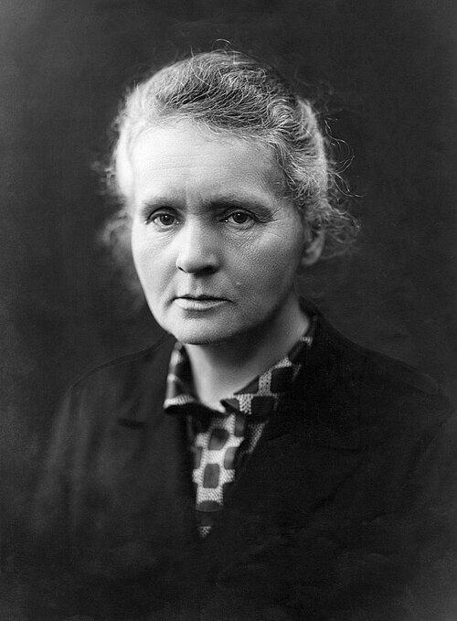

# 玛丽·居里

**英文名：** Marie Curie, née Skłodowska

**生卒：** 1867年11月7日 — 1934年7月4日

**主要领域：** 放射性、核物理

肖像的作者、拍摄或创作年代及具体形式见图片来源。

## 生平简介

玛丽·居里出生于Warsaw, Russian Empire (now Poland)，主要从事放射性、核物理研究。其代表成果包括系统研究放射性，与皮埃尔·居里共同发现钋和镭，获1903年诺贝尔物理学奖。

## 对物理的主要贡献

- 系统研究放射性，与皮埃尔·居里共同发现钋和镭
- 推进放射性元素分离及其物理化学性质研究

**诺贝尔物理学奖：** 1903

## 肖像来源与许可

- 来源：[Marie_Curie_c._1920s.jpg](https://commons.wikimedia.org/wiki/File:Marie_Curie_c._1920s.jpg)
- 作者／署名：Henri Manuel (1874–1947)
- 许可：[Public domain](https://commons.wikimedia.org/wiki/File:Marie_Curie_c._1920s.jpg)
- 本地文件：[f49d0583f2ce007f2528.jpg](../portraits/f49d0583f2ce007f2528.jpg)
- 原始来源说明：cdn-images-1.medium.com

## 资料来源

- [Marie Curie - Facts](https://www.nobelprize.org/prizes/physics/1903/marie-curie/facts/)
- [Nobel Prize official laureate API, id 6](https://api.nobelprize.org/2.1/laureate/6)
- [Wikipedia: Marie Curie](https://en.wikipedia.org/wiki/Marie_Curie)

资料整理日期：2026-10-26。
