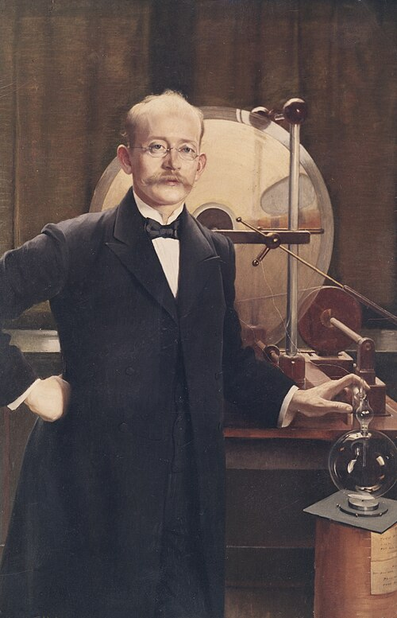

# 克里斯蒂安·比尔克兰

**英文名：** Kristian Birkeland

**生卒：** 1867年12月13日 — 1917年6月15日

**主要领域：** 空间物理、等离子体物理、应用物理

肖像的作者、拍摄或创作年代及具体形式见图片来源。

## 生平简介

挪威物理学家，长期在克里斯蒂安尼亚大学从事电磁与极光研究。他组织北极观测，并用磁化球体和电子束模拟相关现象，同时把高温电弧用于工业固氮，兼具基础与应用研究成果。

## 对物理的主要贡献

- 提出以来自太阳的带电粒子解释极光的重要模型
- 利用地磁观测和磁化球体实验研究空间电流与极光
- 与艾德合作发展电弧固氮工艺

## 肖像来源与许可

- 来源：[Asta_Norregaard_Kristian_Birkeland_1900.jpg](https://commons.wikimedia.org/wiki/File:Asta_Norregaard_Kristian_Birkeland_1900.jpg)
- 作者／署名：Asta Nørregaard (1853–1933)
- 许可：[Public domain](https://commons.wikimedia.org/wiki/Commons:Reuse_of_PD-Art_photographs)
- 本地文件：[c5fd51590b2150ebdbf4-0e1b2eb37b.jpg](../portraits/c5fd51590b2150ebdbf4-0e1b2eb37b.jpg)
- 原始来源说明：Belongs to Hydro company, Oslo

## 资料来源

- [Kristian Birkeland — Norwegian Biographical Lexicon](https://nbl.snl.no/Kristian_Birkeland)
- [Kristian Birkeland — Wikipedia biography](https://en.wikipedia.org/wiki/Kristian_Birkeland)

资料整理日期：2026-10-26。
