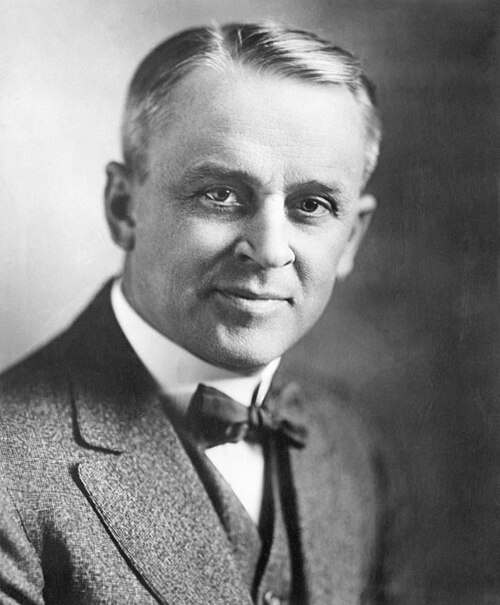

# 罗伯特·密立根

**英文名：** Robert Andrews Millikan

**生卒：** 1868年3月22日 — 1953年12月19日

**主要领域：** 原子物理、精密测量

肖像的作者、拍摄或创作年代及具体形式见图片来源。

## 生平简介

罗伯特·密立根出生于Morrison, IL, USA，主要从事原子物理、精密测量研究。诺贝尔奖资料所列获奖时任职机构为California Institute of Technology (Caltech)。其代表成果包括通过油滴实验精密测定基本电荷，获1923年诺贝尔物理学奖。

## 对物理的主要贡献

- 通过油滴实验精密测定基本电荷
- 实验研究光电效应并检验爱因斯坦关系

**诺贝尔物理学奖：** 1923

## 肖像来源与许可

- 来源：[Millikan.jpg](https://commons.wikimedia.org/wiki/File:Millikan.jpg)
- 作者／署名：Nobel foundation
- 许可：Public domain
- 本地文件：[75d84747932867590e5b.jpg](../portraits/75d84747932867590e5b.jpg)
- 原始来源说明：http://nobelprize.org/nobel_prizes/physics/laureates/1923/millikan-bio.html

## 资料来源

- [Robert A. Millikan - Facts](https://www.nobelprize.org/prizes/physics/1923/millikan/facts/)
- [Nobel Prize official laureate API, id 28](https://api.nobelprize.org/2.1/laureate/28)
- [Wikipedia: Robert Andrews Millikan](https://en.wikipedia.org/wiki/Robert_Andrews_Millikan)

资料整理日期：2026-10-26。
