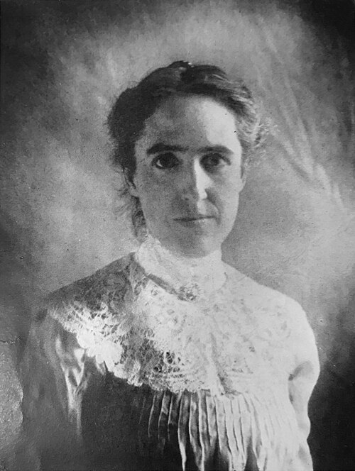

# 亨丽爱塔·斯旺·勒维特

**英文名：** Henrietta Swan Leavitt

**生卒：** 1868年7月4日 — 1921年12月12日

**主要领域：** 恒星物理、宇宙距离尺度、观测天文学

肖像的作者、拍摄或创作年代及具体形式见图片来源。

## 生平简介

美国天文学家，长期在哈佛大学天文台比较照相底片、测量变星亮度。她从麦哲伦云中的造父变星发现周期与亮度的关系，为跨越银河系的距离测量提供尺度，其工作在宇宙学发展中极为关键。

## 对物理的主要贡献

- 发现造父变星的周期—光度关系
- 通过同一星系中近似等距的变星比较，建立亮度与周期的可靠联系
- 为测量银河系尺度和河外星系距离提供重要标准烛光方法

## 肖像来源与许可

- 来源：[Henrietta_Swan_Leavitt.jpg](https://commons.wikimedia.org/wiki/File:Henrietta_Swan_Leavitt.jpg)
- 作者／署名：Unknown author
- 许可：[Public domain](https://commons.wikimedia.org/wiki/File:Henrietta_Swan_Leavitt.jpg)
- 本地文件：[a729bc657b3281946455.jpg](../portraits/a729bc657b3281946455.jpg)
- 原始来源说明：From here, see also [1]. https://lccn.loc.gov/05025712 Popular Astronomy, v. 30, no. 4, April 1922. https://blogs.loc.gov/inside_adams/2019/12/henriettaleavitt/

## 资料来源

- [Henrietta Swan Leavitt — MacTutor, University of St Andrews](https://mathshistory.st-andrews.ac.uk/Biographies/Leavitt/)
- [Henrietta Swan Leavitt — Wikipedia（生卒日期与人物概述）](https://en.wikipedia.org/wiki/Henrietta_Swan_Leavitt)

资料整理日期：2026-10-26。
