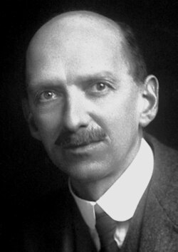

# 查尔斯·汤姆孙·里斯·威尔逊

**英文名：** Charles Thomson Rees Wilson

**生卒：** 1869年2月14日 — 1959年11月15日

**主要领域：** 粒子探测、实验物理

肖像的作者、拍摄或创作年代及具体形式见图片来源。

## 生平简介

查尔斯·汤姆孙·里斯·威尔逊出生于Glencorse, Scotland，主要从事粒子探测、实验物理研究。诺贝尔奖资料所列获奖时任职机构为University of Cambridge。其代表成果包括发明利用过饱和蒸气显示带电粒子径迹的云室，获1927年诺贝尔物理学奖。

## 对物理的主要贡献

- 发明利用过饱和蒸气显示带电粒子径迹的云室
- 开创对单个微观粒子轨迹的直接可视化观测

**诺贝尔物理学奖：** 1927

## 肖像来源与许可

- 来源：[CTR_Wilson.jpg](https://commons.wikimedia.org/wiki/File:CTR_Wilson.jpg)
- 作者／署名：The American Institute of Physics credits the photo [1] to AB Lagrelius & Westphal, which is the Swedish company used by the Nobel Foundation for most photos of its book series Les Prix Nobel.
- 许可：Public domain
- 本地文件：[366e325afc98aff5f41b.jpg](../portraits/366e325afc98aff5f41b.jpg)
- 原始来源说明：http://nobelprize.org/nobel_prizes/physics/laureates/1927/wilson-bio.html

## 资料来源

- [C.T.R. Wilson - Facts](https://www.nobelprize.org/prizes/physics/1927/wilson/facts/)
- [Nobel Prize official laureate API, id 34](https://api.nobelprize.org/2.1/laureate/34)
- [Wikipedia: Charles Thomson Rees Wilson](https://en.wikipedia.org/wiki/Charles_Thomson_Rees_Wilson)

资料整理日期：2026-10-26。
