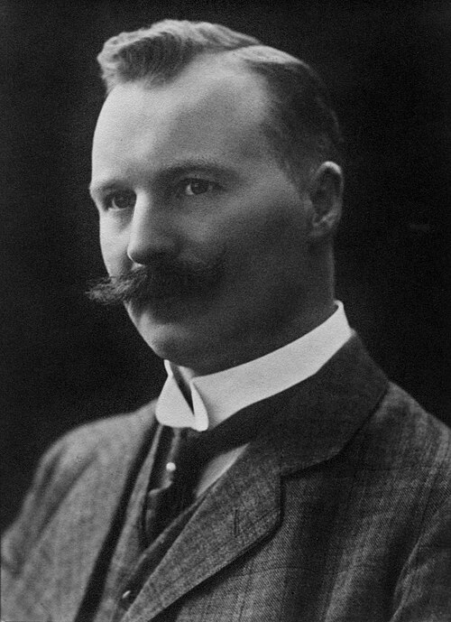

# 古斯塔夫·达伦

**英文名：** Nils Gustaf Dalén

**生卒：** 1869年11月30日 — 1937年12月9日

**主要领域：** 应用物理、光学工程

肖像的作者、拍摄或创作年代及具体形式见图片来源。

## 生平简介

古斯塔夫·达伦出生于Stenstorp, Sweden，主要从事应用物理、光学工程研究。诺贝尔奖资料所列获奖时任职机构为Swedish Gas-Accumulator Co.。其代表成果包括研制用于灯塔和浮标的自动气体调节与日光控制装置，获1912年诺贝尔物理学奖。

## 对物理的主要贡献

- 研制用于灯塔和浮标的自动气体调节与日光控制装置
- 提高航标照明系统的可靠性和燃料使用效率

**诺贝尔物理学奖：** 1912

## 肖像来源与许可

- 来源：[Nils_Gustaf_Dalén.jpg](https://commons.wikimedia.org/wiki/File:Nils_Gustaf_Dal%C3%A9n.jpg)
- 作者／署名：Atelier Jaeger
- 许可：Public domain
- 本地文件：[9188edc4fa80a9f021d4.jpg](../portraits/9188edc4fa80a9f021d4.jpg)
- 原始来源说明：Frank and Frances Carpenter Collection, Library of Congress

## 资料来源

- [Gustaf Dalén - Facts](https://www.nobelprize.org/prizes/physics/1912/dalen/facts/)
- [Nobel Prize official laureate API, id 17](https://api.nobelprize.org/2.1/laureate/17)
- [Wikipedia: Gustaf Dalén](https://en.wikipedia.org/wiki/Gustaf_Dal%C3%A9n)

资料整理日期：2026-10-26。
