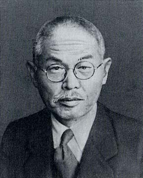

# 本多光太郎

**英文名：** Kotaro Honda

**生卒：** 1870年2月23日 — 1954年2月12日

**主要领域：** 磁学、凝聚态物理、材料物理

肖像的作者、拍摄或创作年代及具体形式见图片来源。

## 生平简介

日本物理学家和冶金研究者，长期在东北帝国大学从事磁学与材料研究，推动金属材料研究机构建设。他把基础磁性测量用于钢铁和合金设计，是日本近代磁性材料和应用物理的重要开拓者。

## 对物理的主要贡献

- 系统研究金属及合金的磁性和热学性质
- 参与研制高性能KS磁钢，促进永久磁体材料发展
- 建立以精密物性测量支持材料设计的研究路线

## 肖像来源与许可

- 来源：[Kotaro_Honda.jpg](https://commons.wikimedia.org/wiki/File:Kotaro_Honda.jpg)
- 作者／署名：共同通信社
- 许可：Public domain
- 本地文件：[c86290b5012b89c88a35.jpg](../portraits/c86290b5012b89c88a35.jpg)
- 原始来源说明：千葉工業大学50年史

## 资料来源

- [Kotaro Honda — Wikipedia（生卒日期与人物概述）](https://en.wikipedia.org/wiki/Kotaro_Honda)

资料整理日期：2026-10-26。
