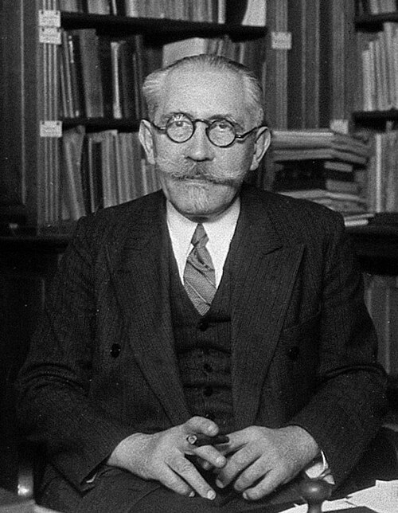

# 保罗·朗之万

**英文名：** Paul Langevin

**生卒：** 1872年1月23日 — 1946年12月19日

**主要领域：** 统计物理、磁学、超声物理

肖像的作者、拍摄或创作年代及具体形式见图片来源。

## 生平简介

法国理论与实验物理学家，长期在巴黎教学和研究，曾在剑桥卡文迪许实验室工作。他研究磁性、布朗运动与相对论，第一次世界大战期间发展超声探测，也积极参与科学教育和国际交流。

## 对物理的主要贡献

- 发展顺磁性和抗磁性的电子理论
- 提出描述布朗运动的朗之万方程，把随机力引入动力学
- 利用压电效应发展超声波水下探测技术，并推广相对论

## 肖像来源与许可

- 来源：[Paul_Langevin_Wellcome2.jpg](https://commons.wikimedia.org/wiki/File:Paul_Langevin_Wellcome2.jpg)
- 作者／署名：Henri Manuel
- 许可：[CC BY 4.0](https://creativecommons.org/licenses/by/4.0)
- 本地文件：[6522a2932306c6a951d4.jpg](../portraits/6522a2932306c6a951d4.jpg)
- 原始来源说明：https://wellcomeimages.org/indexplus/obf_images/f5/f5/fddc87e79e22bf5412905fdc09f9.jpg Gallery: https://wellcomeimages.org/indexplus/image/V0028151.html

## 资料来源

- [Paul Langevin — Wikipedia（生卒日期与人物概述）](https://en.wikipedia.org/wiki/Paul_Langevin)

资料整理日期：2026-10-26。
