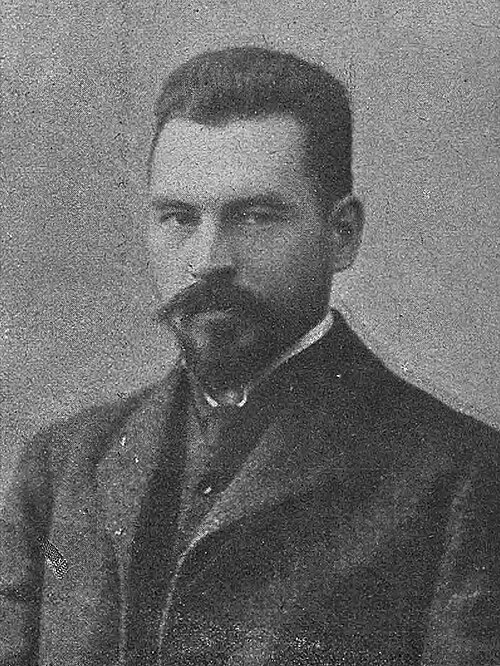

# 马里安·斯莫卢霍夫斯基

**英文名：** Marian Smoluchowski

**生卒：** 1872年5月28日 — 1917年9月5日

**主要领域：** 统计物理、布朗运动、非平衡物理

肖像的作者、拍摄或创作年代及具体形式见图片来源。

## 生平简介

波兰物理学家，在维也纳求学，后在利沃夫和克拉科夫任教。他用概率和分子运动解释布朗运动、涨落和胶体行为，与爱因斯坦的独立研究共同推动原子论的实验验证，是统计物理的主要先驱之一。

## 对物理的主要贡献

- 独立建立布朗运动的理论解释
- 发展扩散、涨落及非平衡随机过程的统计描述
- 提出胶体粒子凝聚的动力学方程

## 肖像来源与许可

- 来源：[Marian_Smoluchowski_(-1913).jpg](https://commons.wikimedia.org/wiki/File:Marian_Smoluchowski_%28-1913%29.jpg)
- 作者／署名：Unknown author
- 许可：Public domain
- 本地文件：[9875fe8d28d056ef3bd1-c6fd4345b6.jpg](../portraits/9875fe8d28d056ef3bd1-c6fd4345b6.jpg)
- 原始来源说明："Nowości Illustrowane" 12/1913 (https://jbc.bj.uj.edu.pl/publication/126944)

## 资料来源

- [Marian Smoluchowski — MacTutor, University of St Andrews](https://mathshistory.st-andrews.ac.uk/Biographies/Smoluchowski/)
- [Marian Smoluchowski — Wikipedia biography](https://en.wikipedia.org/wiki/Marian_Smoluchowski)

资料整理日期：2026-10-26。
