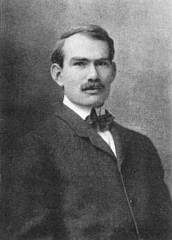

# 李·德福雷斯特

**英文名：** Lee de Forest

**生卒：** 1873年8月26日 — 1961年6月30日

**主要领域：** 电子器件、无线电物理、应用物理

肖像的作者、拍摄或创作年代及具体形式见图片来源。

## 生平简介

美国发明家和电子技术先驱，在耶鲁大学接受物理与电学训练，后从事无线电器件和声电影技术。他在电子管中引入控制栅极，相关器件后来成为电子放大、振荡和广播系统的核心组成部分。

## 对物理的主要贡献

- 发展带控制栅极的三极电子管Audion
- 推动电子管用于电信号放大、调制和振荡
- 研究无线电广播及声电影的电子记录技术

## 史料说明

- 主要身份是工程师与发明家，按电磁学或电子实验技术的重要贡献收录；相应技术发展涉及多位先驱。

## 肖像来源与许可

- 来源：[Lee_De_Forest.jpg](https://commons.wikimedia.org/wiki/File:Lee_De_Forest.jpg)
- 作者／署名：The original uploader was Thbusch at English Wikipedia. Later versions were uploaded by Neutrality at en.wikipedia.
- 许可：Public domain
- 本地文件：[961df7ac03257f6d09b3-c51a1697cc.jpg](../portraits/961df7ac03257f6d09b3-c51a1697cc.jpg)
- 原始来源说明：Transferred from en.wikipedia to Commons.

## 资料来源

- [Lee de Forest — Magnet Academy, National High Magnetic Field Laboratory](https://maglabweb.magnet.fsu.edu/magnet-academy/history-of-electricity-magnetism/pioneers/lee-de-forest/)
- [Lee de Forest — Wikipedia biography](https://en.wikipedia.org/wiki/Lee_de_Forest)

资料整理日期：2026-10-26。
