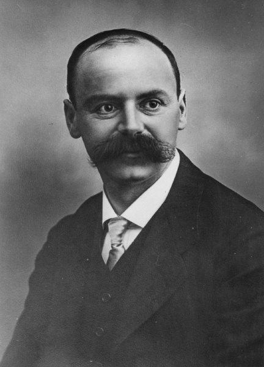

# 卡尔·史瓦西

**英文名：** Karl Schwarzschild

**生卒：** 1873年10月9日 — 1916年5月11日

**主要领域：** 广义相对论、天体物理、观测方法

肖像的作者、拍摄或创作年代及具体形式见图片来源。

## 生平简介

德国天文学家和物理学家，曾主持哥廷根和波茨坦天文研究机构，研究恒星光度、天体测量与理论物理。他在第一次世界大战服役期间求得爱因斯坦引力场方程的首个重要精确解，不久后因病去世。

## 对物理的主要贡献

- 给出球对称真空引力场的史瓦西解，成为黑洞和恒星外部引力研究的基础
- 发展恒星测光和天体辐射研究方法
- 研究天体力学与观测仪器理论

## 肖像来源与许可

- 来源：[Karl_schwarzschild.portrait.jpg](https://commons.wikimedia.org/wiki/File:Karl_schwarzschild.portrait.jpg)
- 作者／署名：Not mentioned
- 许可：Public domain
- 本地文件：[5b721a91b6bf42023266.jpg](../portraits/5b721a91b6bf42023266.jpg)
- 原始来源说明：Here

## 资料来源

- [Karl Schwarzschild — MacTutor, University of St Andrews](https://mathshistory.st-andrews.ac.uk/Biographies/Schwarzschild/)
- [Karl Schwarzschild — Wikipedia（生卒日期与人物概述）](https://en.wikipedia.org/wiki/Karl_Schwarzschild)

资料整理日期：2026-10-26。
