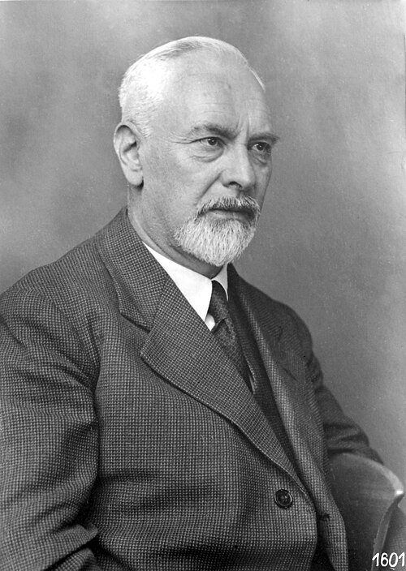

# 路德维希·普朗特

**英文名：** Ludwig Prandtl

**生卒：** 1875年2月4日 — 1953年8月15日

**主要领域：** 流体力学、空气动力学、湍流

肖像的作者、拍摄或创作年代及具体形式见图片来源。

## 生平简介

德国物理学家和工程科学家，长期在哥廷根从事流体与空气动力学研究。他把理论、风洞实验和工程问题结合起来，以边界层概念解释黏性在高速主流附近的关键作用，成为现代空气动力学的主要奠基者。

## 对物理的主要贡献

- 提出边界层理论，连接理想流体近似与真实黏性流动
- 发展机翼升力线理论和风洞实验方法
- 研究湍流、混合长度与可压缩流动

## 肖像来源与许可

- 来源：[Prandtl_portrait.jpg](https://commons.wikimedia.org/wiki/File:Prandtl_portrait.jpg)
- 作者／署名：Unknown author
- 许可：[CC BY 3.0 de](https://commons.wikimedia.org/wiki/File:Prandtl_portrait.jpg)
- 本地文件：[2edc7fbd98d47e7ad6f3.jpg](../portraits/2edc7fbd98d47e7ad6f3.jpg)
- 原始来源说明：DLR-Archiv Göttingen

## 资料来源

- [Ludwig Prandtl — MacTutor, University of St Andrews](https://mathshistory.st-andrews.ac.uk/Biographies/Prandtl/)
- [Ludwig Prandtl — Wikipedia（生卒日期与人物概述）](https://en.wikipedia.org/wiki/Ludwig_Prandtl)

资料整理日期：2026-10-26。
