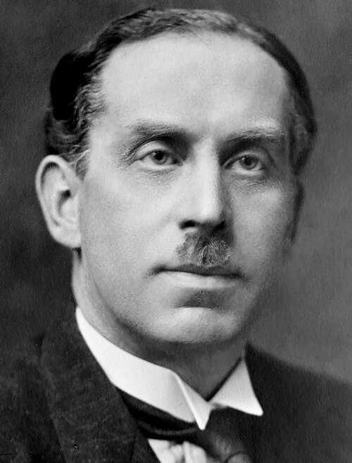

# 查尔斯·巴克拉

**英文名：** Charles Glover Barkla

**生卒：** 1877年6月7日 — 1944年10月23日

**主要领域：** X射线、原子物理

肖像的作者、拍摄或创作年代及具体形式见图片来源。

## 生平简介

查尔斯·巴克拉出生于Widnes, United Kingdom，主要从事X射线、原子物理研究。诺贝尔奖资料所列获奖时任职机构为Edinburgh University。其代表成果包括研究元素的特征X射线，获1917年诺贝尔物理学奖。

## 对物理的主要贡献

- 研究元素的特征X射线
- 证明不同元素具有可识别的X射线谱线特征

**诺贝尔物理学奖：** 1917

## 肖像来源与许可

- 来源：[Charles_Glover_Barkla_01.jpg](https://commons.wikimedia.org/wiki/File:Charles_Glover_Barkla_01.jpg)
- 作者／署名：George Grantham Bain Collection (Library of Congress)
- 许可：Public domain
- 本地文件：[11146e19ec7e9d639108.jpg](../portraits/11146e19ec7e9d639108.jpg)
- 原始来源说明：This image is available from the United States Library of Congress's Prints and Photographs division under the digital ID ggbain.39225.This tag does not indicate the copyright status of the attached work. A normal copyright tag is still required. See Commons:Licensing.

## 资料来源

- [Charles Glover Barkla - Facts](https://www.nobelprize.org/prizes/physics/1917/barkla/facts/)
- [Nobel Prize official laureate API, id 22](https://api.nobelprize.org/2.1/laureate/22)
- [Wikipedia: Charles Glover Barkla](https://en.wikipedia.org/wiki/Charles_Glover_Barkla)

资料整理日期：2026-10-26。
