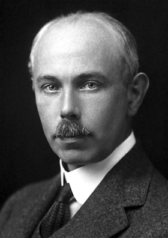

# 弗朗西斯·威廉·阿斯顿

**英文名：** Francis William Aston

**生卒：** 1877年9月1日 — 1945年11月20日

**主要领域：** 质谱学、原子核物理、同位素物理

肖像的作者、拍摄或创作年代及具体形式见图片来源。

## 生平简介

英国实验物理学家，长期在剑桥卡文迪许实验室研究原子质量，1922年获诺贝尔化学奖。他从气体放电和正射线研究发展高精度质谱技术，揭示大量非放射性元素的同位素组成及原子质量规律。

## 对物理的主要贡献

- 研制高分辨质谱仪，测定大量元素的同位素
- 建立整数规则的实验依据，推动原子质量和核结构研究
- 精确质量测量为理解质量亏损与核结合能提供资料

## 肖像来源与许可

- 来源：[Francis_William_Aston.jpg](https://commons.wikimedia.org/wiki/File:Francis_William_Aston.jpg)
- 作者／署名：Unknown author
- 许可：[Public domain](https://commons.wikimedia.org/wiki/File:Francis_William_Aston.jpg)
- 本地文件：[1dd4133471eb3bdf3e37.jpg](../portraits/1dd4133471eb3bdf3e37.jpg)
- 原始来源说明：https://www.nobelprize.org/prizes/chemistry/1922/aston/facts/

## 资料来源

- [Francis William Aston — Wikipedia（生卒日期与人物概述）](https://en.wikipedia.org/wiki/Francis_William_Aston)
- [Francis William Aston — Nobel Prize official biography](https://www.nobelprize.org/prizes/chemistry/1922/aston/biographical/)

资料整理日期：2026-10-26。
