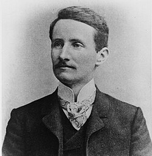

# 瓦尔特·里兹

**英文名：** Walter Ritz

**生卒：** 1878年2月22日 — 1909年7月7日

**主要领域：** 光谱学、变分方法、数学物理

肖像的作者、拍摄或创作年代及具体形式见图片来源。

## 生平简介

瑞士理论物理学家，曾在苏黎世及哥廷根求学研究，因病早逝。他把数学近似方法用于物理边值问题，并从光谱数据提出组合规律；短暂生涯中的两类成果都对后来的物理产生持久影响。

## 对物理的主要贡献

- 提出谱线波数可由基本项之差组成的里兹组合原理
- 发展用于振动和边值问题的里兹变分近似方法
- 研究光谱与电动力学中的理论问题

## 肖像来源与许可

- 来源：[Walther_Ritz.jpg](https://commons.wikimedia.org/wiki/File:Walther_Ritz.jpg)
- 作者／署名：Unknown author
- 许可：[Public domain](https://commons.wikimedia.org/wiki/File:Walther_Ritz.jpg)
- 本地文件：[1ceb254d114a129cc4af-918dcc111e.jpg](../portraits/1ceb254d114a129cc4af-918dcc111e.jpg)
- 原始来源说明：[1]

## 资料来源

- [Gander and Wanner: From Euler, Ritz, and Galerkin to Modern Computing — SIAM Review](https://epubs.siam.org/doi/10.1137/100804036)
- [Walter Ritz — Wikipedia biography](https://en.wikipedia.org/wiki/Walter_Ritz)

资料整理日期：2026-10-26。
