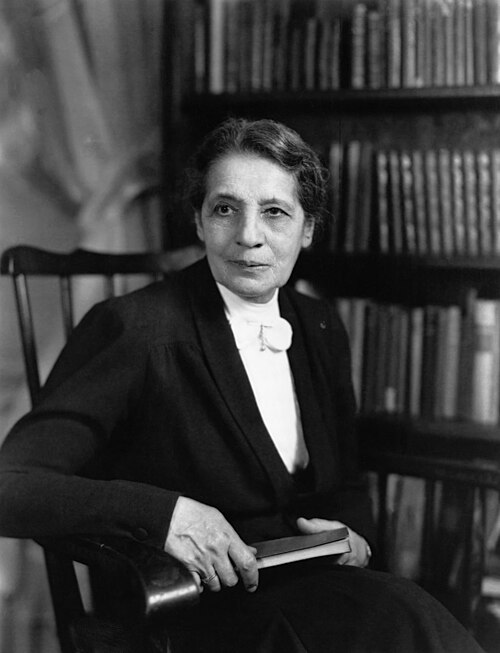

# 莉泽·迈特纳

**英文名：** Lise Meitner

**生卒：** 1878年11月7日 — 1968年10月27日

**主要领域：** 原子核物理、放射性、核裂变

肖像的作者、拍摄或创作年代及具体形式见图片来源。

## 生平简介

奥地利出生、后来成为瑞典公民的核物理学家，长期在柏林与奥托·哈恩合作。因纳粹迫害于1938年流亡瑞典，随后与奥托·弗里施从核物理解释铀裂变；她也是女性进入近代物理研究的关键先驱。

## 对物理的主要贡献

- 与哈恩等合作研究放射性核素，并共同发现镤的长寿命同位素
- 与弗里施提出铀核裂变的物理解释并估算释放能量
- 研究贝塔谱与核辐射，推动早期核物理发展

## 肖像来源与许可

- 来源：[Lise_Meitner_NatGeo.jpg](https://commons.wikimedia.org/wiki/File:Lise_Meitner_NatGeo.jpg)
- 作者／署名：Harris & Ewing
- 许可：Public domain
- 本地文件：[0ccef9d10cf72460bd73.jpg](../portraits/0ccef9d10cf72460bd73.jpg)
- 原始来源说明：https://www.nationalgeographic.com/science/article/nobel-prize-winners-laureates-charts-graphics-science

## 资料来源

- [Lise Meitner — Physics Today, American Institute of Physics](https://physicstoday.aip.org/news/lise-meitner)
- [Lise Meitner — Wikipedia（生卒日期与人物概述）](https://en.wikipedia.org/wiki/Lise_Meitner)

资料整理日期：2026-10-26。
