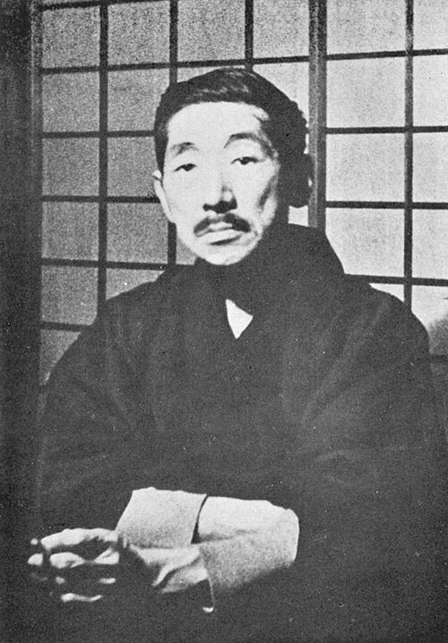

# 寺田寅彦

**英文名：** Torahiko Terada

**生卒：** 1878年11月28日 — 1935年12月31日

**主要领域：** X射线物理、地球物理、实验物理

肖像的作者、拍摄或创作年代及具体形式见图片来源。

## 生平简介

日本物理学家和随笔作家，长期在东京帝国大学从事研究与教学。他研究X射线衍射、地球物理和日常自然现象，重视从观察中提出物理问题，并通过写作传播实验精神和对复杂现象的兴趣。

## 对物理的主要贡献

- 早期开展晶体X射线衍射实验并研究其物理解释
- 研究地震、气象和自然界中的复杂现象
- 推动以实验与细致观察为中心的物理教育和科学传播

## 史料说明

- 出生日期按日本国立国会图书馆为1878年11月28日；部分英文信息框所列12月28日与该来源不符。

## 肖像来源与许可

- 来源：[Torahiko_Terada_01.jpg](https://commons.wikimedia.org/wiki/File:Torahiko_Terada_01.jpg)
- 作者／署名：Unknown author
- 许可：Public domain
- 本地文件：[7ca16047d8f82a5d61a0.jpg](../portraits/7ca16047d8f82a5d61a0.jpg)
- 原始来源说明：English: Japanese book "Showa Literature Series: Vol.3 (December 1952 issue)" published by Kadokawa Shoten.日本語: 角川書店「昭和文学全集3巻（1952年12月発行）」より。

## 资料来源

- [寺田寅彦 — National Diet Library, Japan](https://www.ndl.go.jp/portrait/datas/6078)
- [Torahiko Terada — Wikipedia（生卒日期与人物概述）](https://en.wikipedia.org/wiki/Torahiko_Terada)

资料整理日期：2026-10-26。
