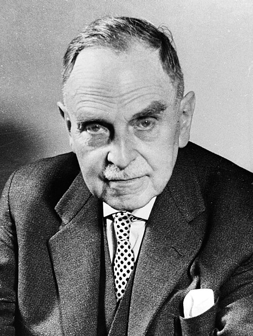

# 奥托·哈恩

**英文名：** Otto Hahn

**生卒：** 1879年3月8日 — 1968年7月28日

**主要领域：** 放射化学、原子核物理、核裂变

肖像的作者、拍摄或创作年代及具体形式见图片来源。

## 生平简介

德国放射化学家，长期在柏林研究放射性核素，战后主持马克斯·普朗克学会，1944年获诺贝尔化学奖。他与迈特纳长期合作，后与施特拉斯曼在铀受中子照射的产物中识别钡，为核裂变发现提供关键证据。

## 对物理的主要贡献

- 与迈特纳等合作发现和研究多种放射性核素
- 与施特拉斯曼通过化学分析发现铀辐照产物中的钡，为核裂变提供决定性实验依据
- 发展放射化学分离与示踪方法

## 史料说明

- 核裂变发现涉及哈恩、施特拉斯曼的化学实验及迈特纳、弗里施的物理解释，应保留各自贡献。

## 肖像来源与许可

- 来源：[Otto_Hahn_1970.jpg](https://commons.wikimedia.org/wiki/File:Otto_Hahn_1970.jpg)
- 作者／署名：Basch, [...] / Opdracht Anefo
- 许可：[CC BY-SA 3.0 nl](https://creativecommons.org/licenses/by-sa/3.0/nl/deed.en)
- 本地文件：[30645633e4e1078106e0.jpg](../portraits/30645633e4e1078106e0.jpg)
- 原始来源说明：[1] Dutch National Archives, The Hague, Fotocollectie Algemeen Nederlands Persbureau (ANEFO), 1945-1989 bekijk toegang 2.24.01.04 Bestanddeelnummer 923-4491

## 资料来源

- [Otto Hahn — Wikipedia（生卒日期与人物概述）](https://en.wikipedia.org/wiki/Otto_Hahn)
- [Otto Hahn — Nobel Prize official biography](https://www.nobelprize.org/prizes/chemistry/1944/hahn/biographical/)

资料整理日期：2026-10-26。
