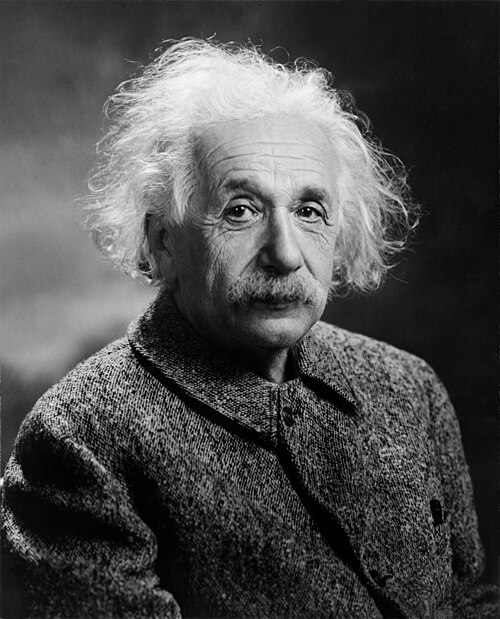

# 阿尔伯特·爱因斯坦

**英文名：** Albert Einstein

**生卒：** 1879年3月14日 — 1955年4月18日

**主要领域：** 相对论、量子论、统计物理

肖像的作者、拍摄或创作年代及具体形式见图片来源。

## 生平简介

阿尔伯特·爱因斯坦出生于Ulm, Germany，主要从事相对论、量子论、统计物理研究。诺贝尔奖资料所列获奖时任职机构为Kaiser-Wilhelm-Institut (now Max-Planck-Institut) für Physik。其代表成果包括提出狭义和广义相对论，改变对时空与引力的认识，获1921年诺贝尔物理学奖。

## 对物理的主要贡献

- 提出狭义和广义相对论，改变对时空与引力的认识
- 用光量子解释光电效应，并研究布朗运动

**诺贝尔物理学奖：** 1921

## 肖像来源与许可

- 来源：[Albert_Einstein_Head_cleaned.jpg](https://commons.wikimedia.org/wiki/File:Albert_Einstein_Head_cleaned.jpg)
- 作者／署名：Oren Jack Turner
- 许可：Public domain
- 本地文件：[930cf9e7c367bb802de6.jpg](../portraits/930cf9e7c367bb802de6.jpg)
- 原始来源说明：This image is available from the United States Library of Congress's Prints and Photographs division under the digital ID cph.3b46036.This tag does not indicate the copyright status of the attached work. A normal copyright tag is still required. See Commons:Licensing.

## 资料来源

- [Albert Einstein - Facts](https://www.nobelprize.org/prizes/physics/1921/einstein/facts/)
- [Nobel Prize official laureate API, id 26](https://api.nobelprize.org/2.1/laureate/26)
- [Wikipedia: Albert Einstein](https://en.wikipedia.org/wiki/Albert_Einstein)

资料整理日期：2026-10-26。
