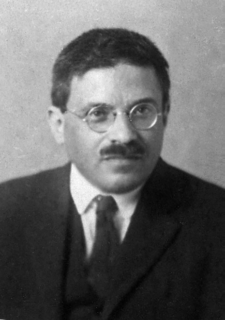

# 保罗·埃伦费斯特

**英文名：** Paul Ehrenfest

**生卒：** 1880年1月18日 — 1933年9月25日

**主要领域：** 统计物理、量子力学

肖像的作者、拍摄或创作年代及具体形式见图片来源。

## 生平简介

奥地利出生的理论物理学家，早年师从玻尔兹曼，后接替洛伦兹在莱顿大学任教。他善于通过思想实验澄清理论，培养了一批量子物理学家，并促进爱因斯坦、玻尔等人的学术交流。

## 对物理的主要贡献

- 提出连接量子期望值运动与经典运动方程的埃伦费斯特定理
- 发展绝热不变量思想，参与旧量子论向量子力学的过渡
- 以热力学导数不连续性讨论相变分类

## 肖像来源与许可

- 来源：[Paul_Ehrenfest.jpg](https://commons.wikimedia.org/wiki/File:Paul_Ehrenfest.jpg)
- 作者／署名：Unknown author
- 许可：Public domain
- 本地文件：[3642c39ca191860867e6.jpg](../portraits/3642c39ca191860867e6.jpg)
- 原始来源说明：Portraits from the Dibner Library of the History of Science and Technology (reworked)

## 资料来源

- [Wikipedia: Paul Ehrenfest](https://en.wikipedia.org/wiki/Paul_Ehrenfest)

资料整理日期：2026-10-26。
