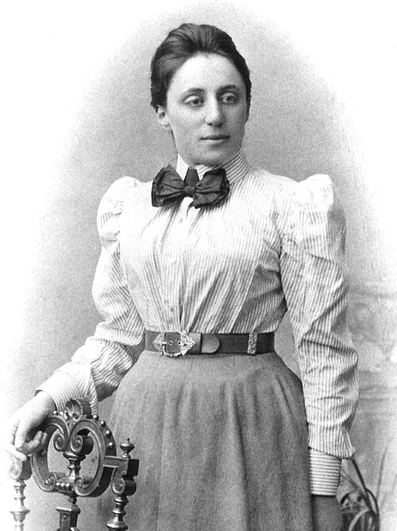

# 埃米·诺特

**英文名：** Emmy Noether

**生卒：** 1882年3月23日 — 1935年4月14日

**主要领域：** 数学物理、对称性

肖像的作者、拍摄或创作年代及具体形式见图片来源。

## 生平简介

德国数学家，曾在哥廷根与希尔伯特、克莱因合作，长期受到女性任教限制。纳粹上台后赴美国布林莫尔学院任教。她的工作把抽象代数与现代物理中的对称性研究紧密联系起来。

## 对物理的主要贡献

- 证明连续对称性与守恒律之间的诺特第一定理
- 建立涉及任意函数对称性的第二定理，为规范场论提供数学基础

## 肖像来源与许可

- 来源：[Emmy_Noether_(3x4_cropped).jpg](https://commons.wikimedia.org/wiki/File:Emmy_Noether_%283x4_cropped%29.jpg)
- 作者／署名：Unknown author Publisher: Mathematical Association of America [3], Brooklyn Museum [4], Agnes Scott College [5], [6]
- 许可：Public domain
- 本地文件：[57ae72bc5b443678511e.jpg](../portraits/57ae72bc5b443678511e.jpg)
- 原始来源说明：Emmy Noether (1882-1935), Archived

## 资料来源

- [MacTutor：Emmy Noether](https://mathshistory.st-andrews.ac.uk/Biographies/Noether_Emmy/)
- [Wikipedia: Emmy Noether](https://en.wikipedia.org/wiki/Emmy_Noether)

资料整理日期：2026-10-26。
