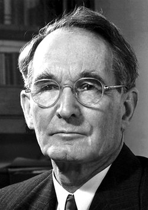

# 珀西·布里奇曼

**英文名：** Percy Williams Bridgman

**生卒：** 1882年4月21日 — 1961年8月20日

**主要领域：** 高压物理、实验技术

肖像的作者、拍摄或创作年代及具体形式见图片来源。

## 生平简介

珀西·布里奇曼出生于Cambridge, MA, USA，主要从事高压物理、实验技术研究。诺贝尔奖资料所列获奖时任职机构为Harvard University。其代表成果包括发明获得超高压的实验装置，获1946年诺贝尔物理学奖。

## 对物理的主要贡献

- 发明获得超高压的实验装置
- 研究物质在极高压力下的性质和相变

**诺贝尔物理学奖：** 1946

## 肖像来源与许可

- 来源：[Bridgman.jpg](https://commons.wikimedia.org/wiki/File:Bridgman.jpg)
- 作者／署名：Nobel foundation
- 许可：Public domain
- 本地文件：[dcb1a5b23569b3cfe68f.jpg](../portraits/dcb1a5b23569b3cfe68f.jpg)
- 原始来源说明：http://nobelprize.org/nobel_prizes/physics/laureates/1946/bridgman-bio.html

## 资料来源

- [Percy W. Bridgman - Facts](https://www.nobelprize.org/prizes/physics/1946/bridgman/facts/)
- [Nobel Prize official laureate API, id 51](https://api.nobelprize.org/2.1/laureate/51)
- [Wikipedia: Percy Williams Bridgman](https://en.wikipedia.org/wiki/Percy_Williams_Bridgman)

资料整理日期：2026-10-26。
