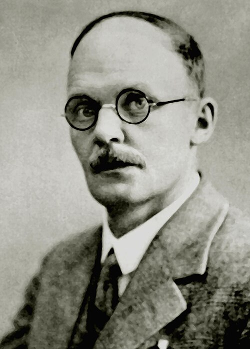

# 汉斯·盖革

**英文名：** Hans Geiger

**生卒：** 1882年9月30日 — 1945年9月24日

**主要领域：** 核物理、实验物理

肖像的作者、拍摄或创作年代及具体形式见图片来源。

## 生平简介

德国实验物理学家，曾在曼彻斯特与卢瑟福合作，后在德国从事放射性和粒子探测研究。他把单个电离粒子的计数发展成精密的实验工具，并参与揭示原子核结构的关键实验。

## 对物理的主要贡献

- 与马斯登开展α粒子大角度散射实验，为卢瑟福的原子核模型提供证据
- 发展早期粒子计数器，并与瓦尔特·米勒制成盖革–米勒计数管
- 与纳托尔建立联系α粒子射程与放射性半衰期的盖革–纳托尔关系

## 肖像来源与许可

- 来源：[Hans_geiger.jpg](https://commons.wikimedia.org/wiki/File:Hans_geiger.jpg)
- 作者／署名：Unknown author
- 许可：Public domain
- 本地文件：[3bfce62b65b467be1a66-260fef4e1d.jpg](../portraits/3bfce62b65b467be1a66-260fef4e1d.jpg)
- 原始来源说明：http://wal.nbed.nb.ca/sciencesettechnologies/pierrebrideau/geiger.jpg

## 资料来源

- [Deutsche Biographie — Hans Geiger](https://www.deutsche-biographie.de/gnd118538144.html)
- [Hans Geiger — reference biography](https://en.wikipedia.org/wiki/Hans_Geiger)

资料整理日期：2026-10-26。
