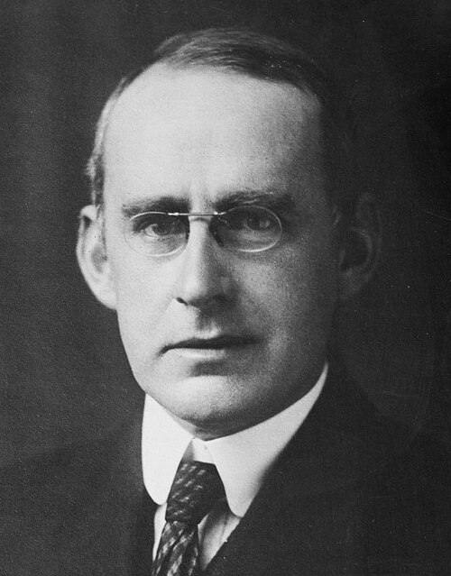

# 阿瑟·爱丁顿

**英文名：** Arthur Eddington

**生卒：** 1882年12月28日 — 1944年11月22日

**主要领域：** 恒星物理、广义相对论

肖像的作者、拍摄或创作年代及具体形式见图片来源。

## 生平简介

英国天体物理学家，长期任职剑桥大学，既研究恒星内部结构，也积极传播广义相对论。他参与组织1919年日食观测，在相对论获得国际关注的过程中发挥重要作用。

## 对物理的主要贡献

- 发展恒星结构与辐射平衡理论
- 提出辐射压力限制天体光度的爱丁顿极限
- 参与1919年日食星光偏折观测

## 肖像来源与许可

- 来源：[Arthur_Stanley_Eddington.jpg](https://commons.wikimedia.org/wiki/File:Arthur_Stanley_Eddington.jpg)
- 作者／署名：George Grantham Bain Collection, Library of Congress Prints and Photographs Division Washington, D.C.
- 许可：Public domain
- 本地文件：[2f0e27224674699b130c.jpg](../portraits/2f0e27224674699b130c.jpg)
- 原始来源说明：This image is available from the United States Library of Congress's Prints and Photographs division under the digital ID ggbain.38064.This tag does not indicate the copyright status of the attached work. A normal copyright tag is still required. See Commons:Licensing.

## 资料来源

- [Wikipedia: Arthur Eddington](https://en.wikipedia.org/wiki/Arthur_Eddington)

资料整理日期：2026-10-26。
