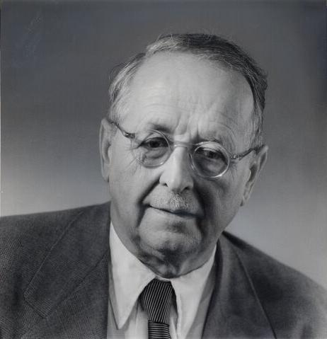

# 赫尔曼·外尔

**英文名：** Hermann Weyl

**生卒：** 1885年11月9日 — 1955年12月8日

**主要领域：** 数学物理、规范理论

肖像的作者、拍摄或创作年代及具体形式见图片来源。

## 生平简介

德国数学家与理论物理学家，曾在哥廷根和苏黎世任教，后移居美国并任职普林斯顿高等研究院。他以群论、几何和分析方法研究相对论及量子理论，影响现代物理的数学语言。

## 对物理的主要贡献

- 提出早期规范不变性思想
- 以群表示论系统研究量子力学与对称性
- 发展外尔旋量及相关的相对论性粒子描述

## 肖像来源与许可

- 来源：[Hermann_Weyl_ETH-Bib_Portr_00890.jpg](https://commons.wikimedia.org/wiki/File:Hermann_Weyl_ETH-Bib_Portr_00890.jpg)
- 作者／署名：ETH Zürich
- 许可：[CC BY-SA 3.0](https://creativecommons.org/licenses/by-sa/3.0)
- 本地文件：[b743d21fee4eabb2dd70.jpg](../portraits/b743d21fee4eabb2dd70.jpg)
- 原始来源说明：ETH-Bibliothek Zürich, Bildarchiv

## 资料来源

- [Wikipedia: Hermann Weyl](https://en.wikipedia.org/wiki/Hermann_Weyl)

资料整理日期：2026-10-26。
