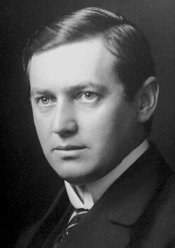

# 曼内·西格巴恩

**英文名：** Karl Manne Georg Siegbahn

**生卒：** 1886年12月3日 — 1978年9月24日

**主要领域：** X射线、光谱学

肖像的作者、拍摄或创作年代及具体形式见图片来源。

## 生平简介

曼内·西格巴恩出生于Örebro, Sweden，主要从事X射线、光谱学研究。诺贝尔奖资料所列获奖时任职机构为Uppsala University。其代表成果包括发展高精度X射线光谱实验方法，获1924年诺贝尔物理学奖。

## 对物理的主要贡献

- 发展高精度X射线光谱实验方法
- 以精密谱线测量推动原子内部结构研究

**诺贝尔物理学奖：** 1924

## 史料说明

- 瑞典国家档案馆《瑞典人物传记辞典》记载1978年9月24日逝世；诺贝尔及英国皇家学会部分旧资料作9月26日。本库采用瑞典本国档案传记的24日，并保留来源分歧。

## 肖像来源与许可

- 来源：[1924_Karl_Manne_Siegbahn.jpg](https://commons.wikimedia.org/wiki/File:1924_Karl_Manne_Siegbahn.jpg)
- 作者／署名：Copyright © The Nobel Foundation 1924
- 许可：Public domain
- 本地文件：[f0a2422d65b492d28736.jpg](../portraits/f0a2422d65b492d28736.jpg)
- 原始来源说明：http://nobelprize.org/nobel_prizes/physics/laureates/1924/siegbahn-bio.html

## 资料来源

- [Manne Siegbahn - Facts](https://www.nobelprize.org/prizes/physics/1924/siegbahn/facts/)
- [Nobel Prize official laureate API, id 29](https://api.nobelprize.org/2.1/laureate/29)
- [Wikipedia: Manne Siegbahn](https://en.wikipedia.org/wiki/Manne_Siegbahn)
- [Swedish National Archives: K Manne G Siegbahn](https://sok.riksarkivet.se/sbl/Presentation.aspx?id=5900)
- [Royal Society catalogue: Karl Manne Georg Siegbahn](https://catalogues.royalsociety.org/CalmView/Record.aspx?id=NA2041&pos=1&src=CalmView.Persons)

资料整理日期：2026-10-26。
