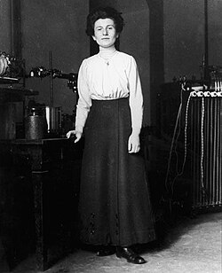

# 海德薇·科恩

**英文名：** Hedwig Kohn

**生卒：** 1887年4月5日 — 1964年11月26日

**主要领域：** 光谱学、实验物理

肖像的作者、拍摄或创作年代及具体形式见图片来源。

## 生平简介

德国出生的实验物理学家，是二战前少数获得德国大学物理任教资格的女性之一。因纳粹迫害离开德国，先后在美国女子学院与杜克大学从事教学和研究。

## 对物理的主要贡献

- 发展火焰辐射强度与定量光谱测量方法
- 利用光谱学研究原子吸收及辐射过程
- 为物理测量手册撰写辐射测量方面的重要章节

## 肖像来源与许可

- 来源：[Hedwig_Kohn.jpg](https://commons.wikimedia.org/wiki/File:Hedwig_Kohn.jpg)
- 作者／署名：Brenda Winnewisser
- 许可：Public domain
- 本地文件：[7e2da9f76ce2d0668287.jpg](../portraits/7e2da9f76ce2d0668287.jpg)
- 原始来源说明：http://jwa.org/media/kohn-hedwig-1-still-image

## 资料来源

- [美国物理联合会：Hertha Sponer and Hedwig Kohn](https://www.aip.org/library/potm-the-letter-h)
- [Wikipedia: Hedwig Kohn](https://en.wikipedia.org/wiki/Hedwig_Kohn)

资料整理日期：2026-10-26。
