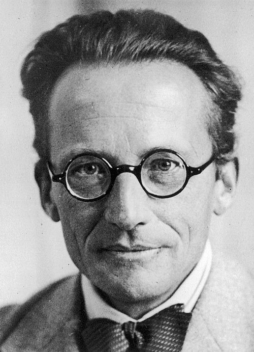

# 埃尔温·薛定谔

**英文名：** Erwin Schrödinger

**生卒：** 1887年8月12日 — 1961年1月4日

**主要领域：** 量子力学、数学物理

肖像的作者、拍摄或创作年代及具体形式见图片来源。

## 生平简介

埃尔温·薛定谔出生于Vienna, Austria，主要从事量子力学、数学物理研究。诺贝尔奖资料所列获奖时任职机构为Berlin University。其代表成果包括建立薛定谔方程和波动力学，获1933年诺贝尔物理学奖。

## 对物理的主要贡献

- 建立薛定谔方程和波动力学
- 用波函数演化描述微观粒子的状态与原子能级

**诺贝尔物理学奖：** 1933

## 肖像来源与许可

- 来源：[Erwin_Schrödinger_-_Narodowe_Archiwum_Cyfrowe_(1-E-939).jpg](https://commons.wikimedia.org/wiki/File:Erwin_Schr%C3%B6dinger_-_Narodowe_Archiwum_Cyfrowe_(1-E-939).jpg)
- 作者／署名：Unknown author
- 许可：Public domain
- 本地文件：[200f876ae1dc18564139.jpg](../portraits/200f876ae1dc18564139.jpg)
- 原始来源说明：Narodowe Archiwum Cyfrowe - Sygnatura 1-E-939 (Original picture)

## 资料来源

- [Erwin Schrödinger - Facts](https://www.nobelprize.org/prizes/physics/1933/schrodinger/facts/)
- [Nobel Prize official laureate API, id 39](https://api.nobelprize.org/2.1/laureate/39)
- [Wikipedia: Erwin Schrödinger](https://en.wikipedia.org/wiki/Erwin_Schr%C3%B6dinger)

资料整理日期：2026-10-26。
