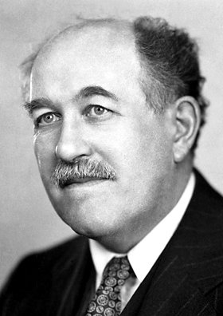

# 奥托·施特恩

**英文名：** Otto Stern

**生卒：** 1888年2月17日 — 1969年8月17日

**主要领域：** 原子物理、分子束

肖像的作者、拍摄或创作年代及具体形式见图片来源。

## 生平简介

奥托·施特恩出生于Sorau, Germany (now Zory, Poland)，主要从事原子物理、分子束研究。诺贝尔奖资料所列获奖时任职机构为Carnegie Institute of Technology。其代表成果包括发展分子束实验并测量质子的磁矩，获1943年诺贝尔物理学奖。

## 对物理的主要贡献

- 发展分子束实验并测量质子的磁矩
- 利用空间量子化实验研究原子磁矩

**诺贝尔物理学奖：** 1943

## 肖像来源与许可

- 来源：[Otto_Stern.jpg](https://commons.wikimedia.org/wiki/File:Otto_Stern.jpg)
- 作者／署名：Nobelprize.org
- 许可：Public domain
- 本地文件：[6a1fe96531f5a8bc456d.jpg](../portraits/6a1fe96531f5a8bc456d.jpg)
- 原始来源说明：http://nobelprize.org/nobel_prizes/physics/laureates/1943/stern-bio.html

## 资料来源

- [Otto Stern - Facts](https://www.nobelprize.org/prizes/physics/1943/stern/facts/)
- [Nobel Prize official laureate API, id 48](https://api.nobelprize.org/2.1/laureate/48)
- [Wikipedia: Otto Stern](https://en.wikipedia.org/wiki/Otto_Stern)

资料整理日期：2026-10-26。
