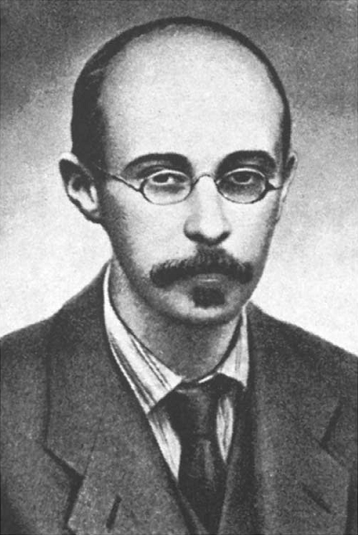

# 亚历山大·弗里德曼

**英文名：** Alexander Friedmann

**生卒：** 1888年6月16日 — 1925年9月16日

**主要领域：** 宇宙学、流体力学

肖像的作者、拍摄或创作年代及具体形式见图片来源。

## 生平简介

俄国数学家与物理学家，曾研究气象和流体力学，后在彼得格勒工作。他在爱因斯坦场方程中找到随时间变化的均匀宇宙解，早逝前已开辟现代动力学宇宙学的重要方向。

## 对物理的主要贡献

- 推导描述均匀各向同性宇宙演化的弗里德曼方程
- 证明广义相对论允许膨胀或收缩的宇宙模型
- 研究湍流及大气动力学

## 史料说明

- 出生日期采用公历；部分俄文历史资料另列儒略历日期。

## 肖像来源与许可

- 来源：[Aleksandr_Fridman.png](https://commons.wikimedia.org/wiki/File:Aleksandr_Fridman.png)
- 作者／署名：Unknown author
- 许可：Public domain
- 本地文件：[520c3129fdb089b3f641.png](../portraits/520c3129fdb089b3f641.png)
- 原始来源说明：Cropped From

## 资料来源

- [Wikipedia: Alexander Friedmann](https://en.wikipedia.org/wiki/Alexander_Friedmann)

资料整理日期：2026-10-26。
