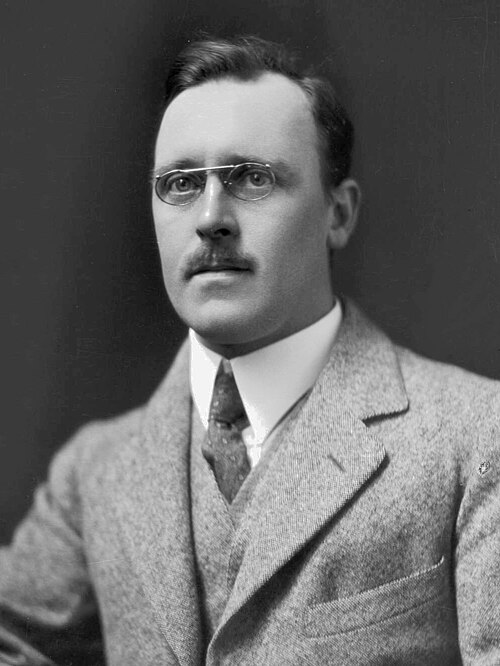

# 欧内斯特·马斯登

**英文名：** Ernest Marsden

**生卒：** 1889年2月19日 — 1970年12月15日

**主要领域：** 核物理、实验物理

肖像的作者、拍摄或创作年代及具体形式见图片来源。

## 生平简介

英国出生的新西兰实验物理学家，在曼彻斯特求学时参与卢瑟福团队的放射性研究。1915年赴惠灵顿任教，后来领导新西兰科学与工业研究部，推动实验物理、雷达与国家科研机构的发展。

## 对物理的主要贡献

- 与盖革发现α粒子穿过薄金属箔时的罕见大角度反散射，促成原子核模型
- 参与早期放射性、α粒子与原子结构实验
- 组织新西兰科研体系，并推动第二次世界大战期间的本土雷达研究

## 肖像来源与许可

- 来源：[Ernest_Marsden_1921.jpg](https://commons.wikimedia.org/wiki/File:Ernest_Marsden_1921.jpg)
- 作者／署名：S P Andrew Ltd.
- 许可：Public domain
- 本地文件：[cd3d57c09efb4d5f3ba2-c37b8a966f.jpg](../portraits/cd3d57c09efb4d5f3ba2-c37b8a966f.jpg)
- 原始来源说明：http://mp.natlib.govt.nz/detail/?id=27055&l=en

## 资料来源

- [Te Ara — Ernest Marsden](https://teara.govt.nz/en/biographies/4m41/marsden-ernest)
- [Museum of New Zealand Te Papa — Sir Ernest Marsden](https://collections.tepapa.govt.nz/Person/45905)
- [Ernest Marsden — reference biography](https://en.wikipedia.org/wiki/Ernest_Marsden)

资料整理日期：2026-10-26。
