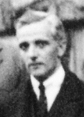

# 莱昂·布里渊

**英文名：** Léon Brillouin

**生卒：** 1889年8月7日 — 1969年10月4日

**主要领域：** 固体物理、波动理论

肖像的作者、拍摄或创作年代及具体形式见图片来源。

## 生平简介

法国理论物理学家，出身物理学家庭，先后在法国与美国工作。他研究晶体中的电子和声波传播，后将统计物理思想用于信息论，连接了通信与热力学问题。

## 对物理的主要贡献

- 提出晶体倒易空间中的布里渊区概念
- 预言光与声学激发相互作用产生的布里渊散射
- 参与建立WKB近似并研究信息与熵的联系

## 肖像来源与许可

- 来源：[Léon_Brillouin_Solvay_conference_1927.jpg](https://commons.wikimedia.org/wiki/File:L%C3%A9on_Brillouin_Solvay_conference_1927.jpg)
- 作者／署名：Solvay_conference_1927.jpg: Benjamin Couprie, Institut International de Physique de Solvay derivative work: Setreset (talk)
- 许可：Public domain
- 本地文件：[edc5d19c8eaeb3b888d7.jpg](../portraits/edc5d19c8eaeb3b888d7.jpg)
- 原始来源说明：Solvay_conference_1927.jpg

## 资料来源

- [Wikipedia: Léon Brillouin](https://en.wikipedia.org/wiki/L%C3%A9on_Brillouin)

资料整理日期：2026-10-26。
