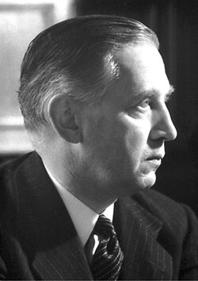

# 爱德华·阿普尔顿

**英文名：** Sir Edward Victor Appleton

**生卒：** 1892年9月6日 — 1965年4月21日

**主要领域：** 空间物理、电离层

肖像的作者、拍摄或创作年代及具体形式见图片来源。

## 生平简介

爱德华·阿普尔顿出生于Bradford, United Kingdom，主要从事空间物理、电离层研究。诺贝尔奖资料所列获奖时任职机构为Department of Scientific and Industrial Research。其代表成果包括通过无线电实验探测高层大气的电离层，获1947年诺贝尔物理学奖。

## 对物理的主要贡献

- 通过无线电实验探测高层大气的电离层
- 确定反射无线电的高层电离区域

**诺贝尔物理学奖：** 1947

## 肖像来源与许可

- 来源：[Appleton.jpg](https://commons.wikimedia.org/wiki/File:Appleton.jpg)
- 作者／署名：Nobel foundation
- 许可：Public domain
- 本地文件：[59c2a0d053123724148d.jpg](../portraits/59c2a0d053123724148d.jpg)
- 原始来源说明：http://nobelprize.org/nobel_prizes/physics/laureates/1947/appleton-bio.html

## 资料来源

- [Edward V. Appleton - Facts](https://www.nobelprize.org/prizes/physics/1947/appleton/facts/)
- [Nobel Prize official laureate API, id 52](https://api.nobelprize.org/2.1/laureate/52)
- [Wikipedia: Edward Victor Appleton](https://en.wikipedia.org/wiki/Edward_Victor_Appleton)

资料整理日期：2026-10-26。
