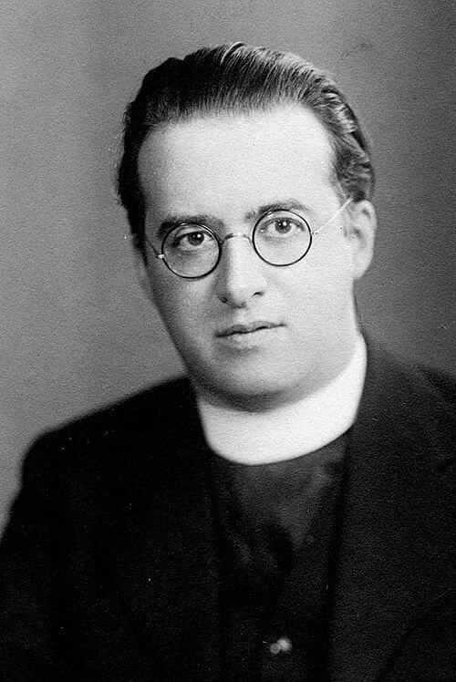

# 乔治·勒梅特

**英文名：** Georges Lemaître

**生卒：** 1894年7月17日 — 1966年6月20日

**主要领域：** 宇宙学

肖像的作者、拍摄或创作年代及具体形式见图片来源。

## 生平简介

比利时物理学家和天主教神父，曾在剑桥及麻省理工学院学习，后任教于鲁汶大学。他将广义相对论解与星系观测联系起来，提出宇宙从高密度早期状态演化的设想。

## 对物理的主要贡献

- 独立提出膨胀宇宙模型并给出距离与退行速度关系
- 提出原始原子假说，成为热大爆炸观念的历史先声
- 发展相对论宇宙学模型

## 肖像来源与许可

- 来源：[GLemaitre30.jpg](https://commons.wikimedia.org/wiki/File:GLemaitre30.jpg)
- 作者／署名：Unknown author
- 许可：[Public domain](https://commons.wikimedia.org/wiki/File:GLemaitre30.jpg)
- 本地文件：[162b26bbf740c73b7187.jpg](../portraits/162b26bbf740c73b7187.jpg)
- 原始来源说明：https://societyforthehistoryofastronomy.com/wp-content/uploads/2023/01/AA14-June-20.pdf

## 资料来源

- [Wikipedia: Georges Lemaître](https://en.wikipedia.org/wiki/Georges_Lema%C3%AEtre)

资料整理日期：2026-10-26。
