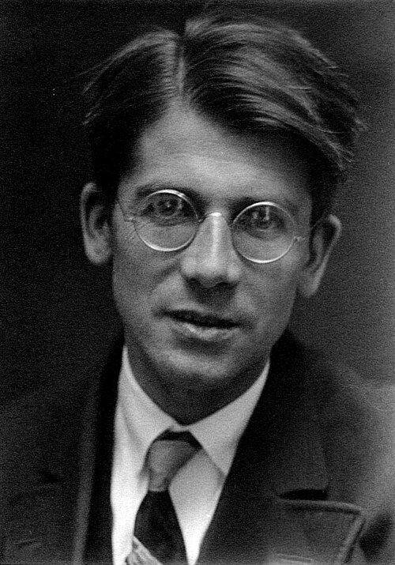

# 弗里德里希·洪德

**英文名：** Friedrich Hund

**生卒：** 1896年2月4日 — 1997年3月31日

**主要领域：** 原子物理、分子物理、量子力学

肖像的作者、拍摄或创作年代及具体形式见图片来源。

## 生平简介

德国理论物理学家，先后在莱比锡、耶拿、法兰克福和哥廷根等地任教。他研究原子与分子的量子结构，把光谱规律与电子态联系起来，并通过专著与教学影响量子物理的发展，晚年亦研究物理学史。

## 对物理的主要贡献

- 提出洪德规则，用于判断原子电子组态的能级排列
- 与穆利肯等发展分子轨道和分子光谱的量子描述
- 早期研究分子中的量子隧穿现象

## 肖像来源与许可

- 来源：[Hund,_Friedrich_1920er_Göttingen.jpg](https://commons.wikimedia.org/wiki/File:Hund,_Friedrich_1920er_G%C3%B6ttingen.jpg)
- 作者／署名：GFHund
- 许可：[CC BY 3.0](https://creativecommons.org/licenses/by/3.0)
- 本地文件：[8b7a825d26ee666e246e-cb24399e04.jpg](../portraits/8b7a825d26ee666e246e-cb24399e04.jpg)
- 原始来源说明：Own work

## 资料来源

- [Saxon Academy of Sciences: Friedrich Hund](https://www.saw-leipzig.de/de/personen/hundf)
- [Jena University: Friedrich Hermann Hund](https://www.physik.uni-jena.de/4030/hund-friedrich-hermann-1896-1997)
- [Friedrich Hund family memorial and scientific biography](https://www.teleschach.de/teleschach/f_hund.htm)
- [Wikipedia: Friedrich Hund](https://en.wikipedia.org/wiki/Friedrich_Hund)

资料整理日期：2026-10-26。
