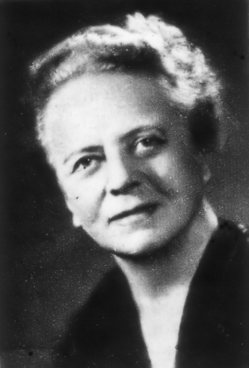

# 伊达·诺达克

**英文名：** Ida Noddack

**生卒：** 1896年2月25日 — 1978年9月24日

**主要领域：** 核科学、分析化学

肖像的作者、拍摄或创作年代及具体形式见图片来源。

## 生平简介

德国化学家与物理学研究者，与瓦尔特·诺达克及奥托·贝格合作发现铼元素。她在中子轰击实验解释尚未明朗时提出重核可能分裂为较大碎片，属于核裂变概念的重要先声。

## 对物理的主要贡献

- 共同发现原子序数75的铼元素
- 1934年提出受中子轰击的重核可能裂成较大碎片
- 发展痕量元素分析研究

## 肖像来源与许可

- 来源：[Ida_Noddack-Tacke.png](https://commons.wikimedia.org/wiki/File:Ida_Noddack-Tacke.png)
- 作者／署名：Unknown author
- 许可：[GFDL](https://en.wikipedia.org/wiki/en:Creative_Commons)
- 本地文件：[29abc5c4864f34569307.png](../portraits/29abc5c4864f34569307.png)
- 原始来源说明：privates Familienalbum

## 资料来源

- [美国物理联合会：Ida Noddack](https://physicstoday.aip.org/news/ida-noddack)
- [Wikipedia: Ida Noddack](https://en.wikipedia.org/wiki/Ida_Noddack)

资料整理日期：2026-10-26。
