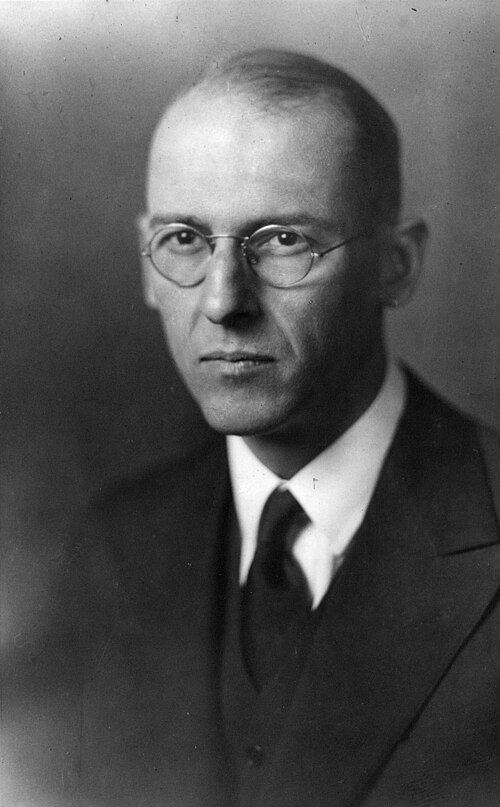

# 莱斯特·格默

**英文名：** Lester Germer

**生卒：** 1896年10月10日 — 1971年10月

**主要领域：** 量子物理、表面物理

肖像的作者、拍摄或创作年代及具体形式见图片来源。

## 生平简介

美国实验物理学家，长期在贝尔实验室工作，退休后在康奈尔大学继续研究。他与克林顿·戴维森合作发现晶体对电子的衍射，为德布罗意物质波假说提供了决定性的实验支持。

## 对物理的主要贡献

- 与戴维森于1927年发现镍晶体对电子的衍射，验证电子的波动性
- 发展电子衍射方法，用于研究晶体和表面结构
- 研究热电子发射、金属表面及电接触现象

## 史料说明

- 姓名为Lester Halbert Germer，不是Louis Germer。
- 逝世日期通常记为1971年10月3日，但琳达·霍尔图书馆的传记记为10月4日；本档案保留月份并列明分歧，待同时代原始记录进一步核实。

## 肖像来源与许可

- 来源：[Germer_Lester_A2.jpg](https://commons.wikimedia.org/wiki/File:Germer_Lester_A2.jpg)
- 作者／署名：Credit Line: AIP Emilio Segrè Visual Archives
- 许可：Copyrighted free use
- 本地文件：[c96841785b45b92497d0-4bb7951268.jpg](../portraits/c96841785b45b92497d0-4bb7951268.jpg)
- 原始来源说明：https://repository.aip.org/islandora/object/nbla%3A297939

## 资料来源

- [American Physical Society — Bell Laboratories historic site](https://www.aps.org/funding-recognition/historic-sites/bell-laboratories-building)
- [AIP — Lester Germer papers](https://history.aip.org/history/catalog/icos/1403.html)
- [University of Colorado — Davisson–Germer experiment](https://www-hep.colorado.edu/~jcumalat/phys2170_f13/lectures/Lec18.pdf)
- [Linda Hall Library — Lester Germer](https://www.lindahall.org/about/news/scientist-of-the-day/lester-germer/)
- [Lester Germer — reference biography](https://en.wikipedia.org/wiki/Lester_Germer)

资料整理日期：2026-10-26。
