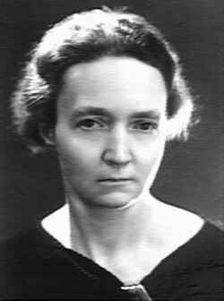

# 伊雷娜·约里奥-居里

**英文名：** Irène Joliot-Curie

**生卒：** 1897年9月12日 — 1956年3月17日

**主要领域：** 核物理、放射性

肖像的作者、拍摄或创作年代及具体形式见图片来源。

## 生平简介

法国物理化学家，玛丽与皮埃尔·居里的女儿，长期在巴黎镭研究所工作。她与弗雷德里克·约里奥-居里合作研究核反应，因发现人工放射性共同获1935年诺贝尔化学奖。

## 对物理的主要贡献

- 与弗雷德里克共同发现人工放射性
- 研究轻元素的α粒子诱发核反应及正电子放射
- 推动放射性同位素制备和法国核研究

## 肖像来源与许可

- 来源：[Irène_Joliot-Curie_Harcourt.jpg](https://commons.wikimedia.org/wiki/File:Ir%C3%A8ne_Joliot-Curie_Harcourt.jpg)
- 作者／署名：Harcourt
- 许可：Public domain
- 本地文件：[2572ca12a11a0e87faf2.jpg](../portraits/2572ca12a11a0e87faf2.jpg)
- 原始来源说明：[1]

## 资料来源

- [Wikipedia: Irène Joliot-Curie](https://en.wikipedia.org/wiki/Ir%C3%A8ne_Joliot-Curie)

资料整理日期：2026-10-26。
