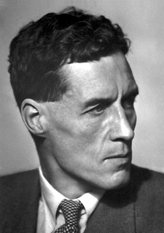

# 帕特里克·布莱克特

**英文名：** Patrick Maynard Stuart Blackett

**生卒：** 1897年11月18日 — 1974年7月13日

**主要领域：** 粒子物理、宇宙线

肖像的作者、拍摄或创作年代及具体形式见图片来源。

## 生平简介

帕特里克·布莱克特出生于London, United Kingdom，主要从事粒子物理、宇宙线研究。诺贝尔奖资料所列获奖时任职机构为Victoria University。其代表成果包括改进云室及自动触发技术，获1948年诺贝尔物理学奖。

## 对物理的主要贡献

- 改进云室及自动触发技术
- 以宇宙线实验研究正电子与粒子簇射

**诺贝尔物理学奖：** 1948

## 肖像来源与许可

- 来源：[Blackett.jpg](https://commons.wikimedia.org/wiki/File:Blackett.jpg)
- 作者／署名：Nobel foundation
- 许可：Public domain
- 本地文件：[df097f2149f6de9db12b.jpg](../portraits/df097f2149f6de9db12b.jpg)
- 原始来源说明：http://nobelprize.org/nobel_prizes/physics/laureates/1948/blackett-bio.html

## 资料来源

- [Patrick M.S. Blackett - Facts](https://www.nobelprize.org/prizes/physics/1948/blackett/facts/)
- [Nobel Prize official laureate API, id 53](https://api.nobelprize.org/2.1/laureate/53)
- [Wikipedia: Patrick Blackett, Baron Blackett](https://en.wikipedia.org/wiki/Patrick_Blackett%2C_Baron_Blackett)

资料整理日期：2026-10-26。
