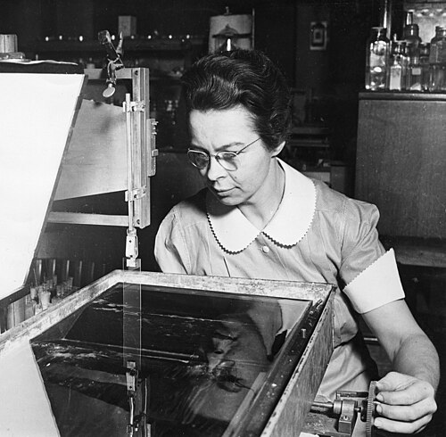

# 凯瑟琳·伯尔·布洛杰特

**英文名：** Katharine Burr Blodgett

**生卒：** 1898年1月10日 — 1979年10月12日

**主要领域：** 表面物理、光学薄膜

肖像的作者、拍摄或创作年代及具体形式见图片来源。

## 生平简介

美国实验物理学家，曾在剑桥大学取得物理学博士学位，长期在通用电气研究实验室与朗缪尔合作。她将单分子层研究推进为精密薄膜技术，并用于光学表面处理。

## 对物理的主要贡献

- 与朗缪尔发展可控转移单分子层的朗缪尔—布洛杰特薄膜技术
- 利用薄膜干涉制造低反射玻璃
- 研究表面膜厚度测量及界面性质

## 肖像来源与许可

- 来源：[Katharine_Burr_Blodgett_(1898-1979),_demonstrating_equipment_in_lab.jpg](https://commons.wikimedia.org/wiki/File:Katharine_Burr_Blodgett_(1898-1979),_demonstrating_equipment_in_lab.jpg)
- 作者／署名：Smithsonian Institution from United States
- 许可：[No restrictions](https://www.flickr.com/commons/usage/)
- 本地文件：[ebbf62cf2fb00dc91505.jpg](../portraits/ebbf62cf2fb00dc91505.jpg)
- 原始来源说明：Katharine Burr Blodgett (1898-1979), demonstrating equipment in lab

## 资料来源

- [美国物理联合会：Katharine Burr Blodgett讣告](https://physicstoday.aip.org/obituaries/katharine-burr-blodgett)
- [Wikipedia: Katharine Burr Blodgett](https://en.wikipedia.org/wiki/Katharine_Burr_Blodgett)

资料整理日期：2026-10-26。
