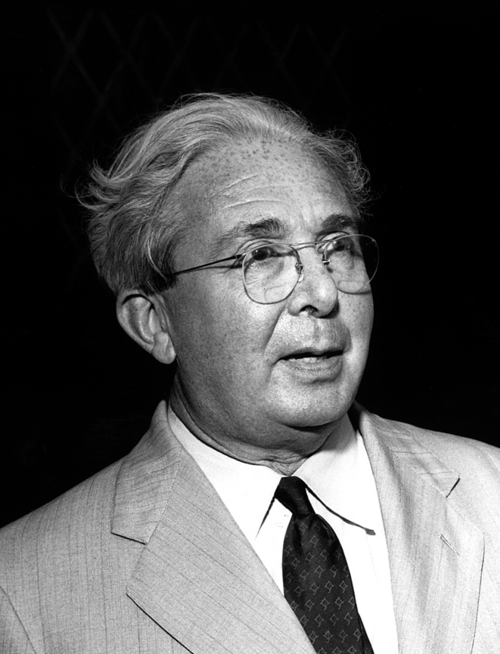

# 利奥·西拉德

**英文名：** Leo Szilard

**生卒：** 1898年2月11日 — 1964年5月30日

**主要领域：** 核物理、统计物理

肖像的作者、拍摄或创作年代及具体形式见图片来源。

## 生平简介

匈牙利出生的物理学家，曾在德国和英国研究，后移居美国。他较早认识到核链式反应的可能性，参与芝加哥核反应堆项目，战后积极推动核武器国际控制。

## 对物理的主要贡献

- 提出自持核链式反应的设想并参与反应堆研究
- 以单分子热机讨论测量、信息与熵的关系
- 参与研究中子增殖及核能技术

## 肖像来源与许可

- 来源：[Leo_Szilard-cropped.png](https://commons.wikimedia.org/wiki/File:Leo_Szilard-cropped.png)
- 作者／署名：unknown photographer Furfur
- 许可：Public domain
- 本地文件：[33fcd4accea9645bf6bc.png](../portraits/33fcd4accea9645bf6bc.png)
- 原始来源说明：Leo_Szilard.jpg

## 资料来源

- [美国国家公园管理局：Leo Szilard](https://home.nps.gov/people/manhattan-project-scientists-leo-szilard.htm)
- [Wikipedia: Leó Szilárd](https://en.wikipedia.org/wiki/Le%C3%B3_Szil%C3%A1rd)

资料整理日期：2026-10-26。
