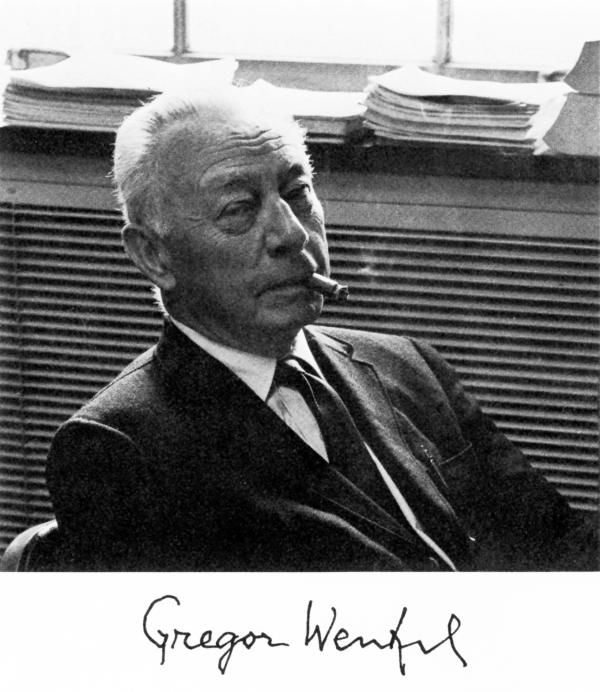

# 格雷戈尔·文策尔

**英文名：** Gregor Wentzel

**生卒：** 1898年2月17日 — 1978年8月12日

**主要领域：** 量子力学、量子场论

原样提取自美国国家科学院学者撰写的Gregor Wentzel传记首页肖像嵌入图像，已目视核对。

## 生平简介

德国出生的理论物理学家，先后在欧洲及芝加哥大学任教。他参与早期量子理论发展，后来研究介子理论与量子场论，并以系统的理论著述影响研究生教学。

## 对物理的主要贡献

- 参与建立WKB半经典近似方法
- 研究量子散射、介子理论及场量子化
- 将渐近展开方法用于量子运动问题

## 肖像来源与许可

- 来源：[gregor-wentzel.png](https://arxiv.org/pdf/0809.2102)
- 作者／署名：见原图页面
- 许可：版权所有或再发布授权未确认；公开网页使用前须核查授权
- 本地文件：[8b52b4e1a78e2841eea1-6b4ee7ae49.png](../portraits/8b52b4e1a78e2841eea1-6b4ee7ae49.png)
- 授权状态：仅记录来源与本地档案副本；未确认可用于网站再发布，发布前须向权利人核实授权。

## 资料来源

- [苏黎世大学物理研究所：Gregor Wentzel](https://ikarus.physik.uzh.ch/de/institut/emeriti/Gregor-Wentzel.html)
- [Wikipedia: Gregor Wentzel](https://en.wikipedia.org/wiki/Gregor_Wentzel)

资料整理日期：2026-10-26。
