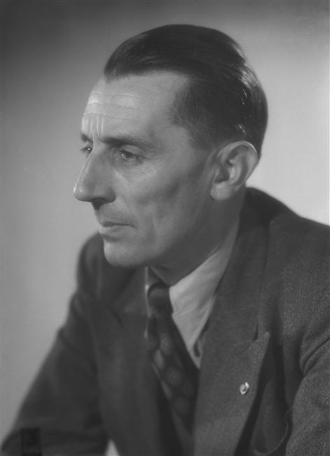

# 弗雷德里克·约里奥-居里

**英文名：** Frédéric Joliot-Curie

**生卒：** 1900年3月19日 — 1958年8月14日

**主要领域：** 核物理、放射性

肖像的作者、拍摄或创作年代及具体形式见图片来源。

## 生平简介

法国实验物理学家，曾在巴黎镭研究所工作，与伊雷娜·约里奥-居里共同获1935年诺贝尔化学奖。战后参与创建法国原子能机构并组织早期反应堆研究。

## 对物理的主要贡献

- 与伊雷娜共同发现人工放射性
- 研究核裂变释放中子及链式反应的可能性
- 推动建造法国早期核反应堆

## 肖像来源与许可

- 来源：[Joliot-Curie_Harcourt_1948_3.jpg](https://commons.wikimedia.org/wiki/File:Joliot-Curie_Harcourt_1948_3.jpg)
- 作者／署名：Studio Harcourt
- 许可：Public domain
- 本地文件：[805303115cfd206bd8f8.jpg](../portraits/805303115cfd206bd8f8.jpg)
- 原始来源说明：RMN

## 资料来源

- [Wikipedia: Frédéric Joliot-Curie](https://en.wikipedia.org/wiki/Fr%C3%A9d%C3%A9ric_Joliot-Curie)

资料整理日期：2026-10-26。
