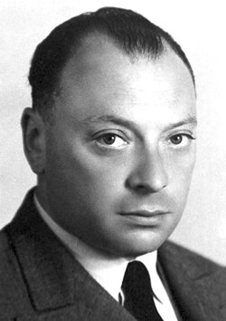

# 沃尔夫冈·泡利

**英文名：** Wolfgang Pauli

**生卒：** 1900年4月25日 — 1958年12月15日

**主要领域：** 量子力学、粒子物理

肖像的作者、拍摄或创作年代及具体形式见图片来源。

## 生平简介

沃尔夫冈·泡利出生于Vienna, Austria，主要从事量子力学、粒子物理研究。诺贝尔奖资料所列获奖时任职机构为Princeton University。其代表成果包括提出不相容原理，解释电子壳层与物质结构，获1945年诺贝尔物理学奖。

## 对物理的主要贡献

- 提出不相容原理，解释电子壳层与物质结构
- 提出中微子假说以说明β衰变能量问题

**诺贝尔物理学奖：** 1945

## 肖像来源与许可

- 来源：[Pauli.jpg](https://commons.wikimedia.org/wiki/File:Pauli.jpg)
- 作者／署名：Nobel foundation
- 许可：Public domain
- 本地文件：[41fa828e7fef4b79e903.jpg](../portraits/41fa828e7fef4b79e903.jpg)
- 原始来源说明：http://nobelprize.org/nobel_prizes/physics/laureates/1945/pauli-bio.html

## 资料来源

- [Wolfgang Pauli - Facts](https://www.nobelprize.org/prizes/physics/1945/pauli/facts/)
- [Nobel Prize official laureate API, id 50](https://api.nobelprize.org/2.1/laureate/50)
- [Wikipedia: Wolfgang Pauli](https://en.wikipedia.org/wiki/Wolfgang_Pauli)

资料整理日期：2026-10-26。
