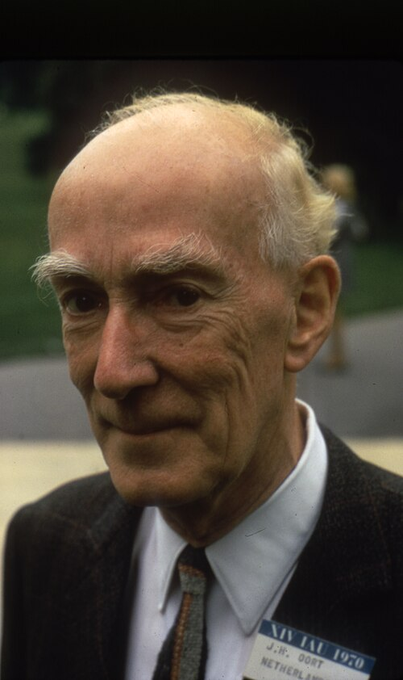

# 扬·奥尔特

**英文名：** Jan Oort

**生卒：** 1900年4月28日 — 1992年11月5日

**主要领域：** 银河系天文学、射电天文学

肖像的作者、拍摄或创作年代及具体形式见图片来源。

## 生平简介

荷兰天文学家，长期在莱顿天文台工作并担任台长。他以银河系恒星运动研究起步，后推动荷兰射电天文学发展，利用观测揭示银河系结构与旋转规律。

## 对物理的主要贡献

- 用恒星运动确定银河系差异旋转并定义奥尔特常数
- 推动以中性氢21厘米谱线研究银河系结构
- 提出长周期彗星来源的奥尔特云假说

## 肖像来源与许可

- 来源：[Jan_Oort_1970.jpg](https://commons.wikimedia.org/wiki/File:Jan_Oort_1970.jpg)
- 作者／署名：AIP Emilio Segrè Visual Archives, John Irwin Slide Collection
- 许可：Attribution
- 本地文件：[7c0e54975ce9648119f8.jpg](../portraits/7c0e54975ce9648119f8.jpg)
- 原始来源说明：https://repository.aip.org/jan-oort-international-astronomical-union-iau-meeting

## 资料来源

- [Wikipedia: Jan Oort](https://en.wikipedia.org/wiki/Jan_Oort)

资料整理日期：2026-10-26。
