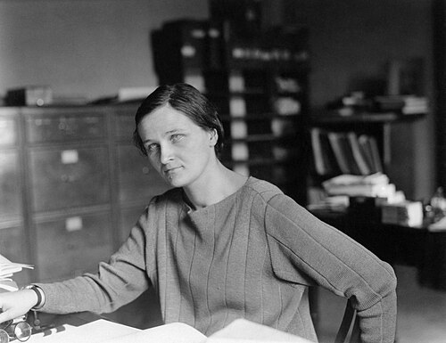

# 塞西莉娅·佩恩-加波施金

**英文名：** Cecilia Payne-Gaposchkin

**生卒：** 1900年5月10日 — 1979年12月7日

**主要领域：** 恒星物理、天体光谱

肖像的作者、拍摄或创作年代及具体形式见图片来源。

## 生平简介

英国出生的天体物理学家，赴哈佛大学研究恒星光谱并完成博士论文，后来成为哈佛大学首位获正式教授职位的女性之一。她将量子原子物理用于理解恒星化学组成。

## 对物理的主要贡献

- 应用萨哈电离理论解释恒星光谱序列
- 论证恒星主要由氢和氦组成
- 长期研究变星及恒星演化

## 肖像来源与许可

- 来源：[Cecilia_Helena_Payne-Gaposchkin_(1900-1979)_-_Science_Service.jpg](https://commons.wikimedia.org/wiki/File:Cecilia_Helena_Payne-Gaposchkin_(1900-1979)_-_Science_Service.jpg)
- 作者／署名：Smithsonian Institution/Science Service, restored by Adam Cuerden
- 许可：Public domain
- 本地文件：[2d05576d3d9bc644c54b.jpg](../portraits/2d05576d3d9bc644c54b.jpg)
- 原始来源说明：Air and Space Museum online gallery

## 资料来源

- [Wikipedia: Cecilia Payne-Gaposchkin](https://en.wikipedia.org/wiki/Cecilia_Payne-Gaposchkin)

资料整理日期：2026-10-26。
