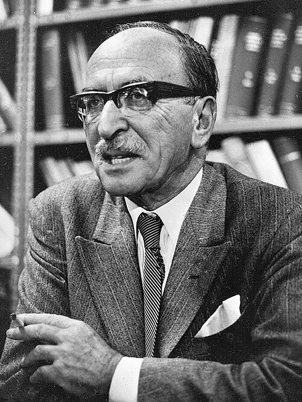

# 加博尔·德奈什

**英文名：** Dennis Gabor

**生卒：** 1900年6月5日 — 1979年2月9日

**主要领域：** 光学、全息成像

肖像的作者、拍摄或创作年代及具体形式见图片来源。

## 生平简介

加博尔·德奈什出生于Budapest, Hungary，主要从事光学、全息成像研究。诺贝尔奖资料所列获奖时任职机构为Imperial College。其代表成果包括提出并发展全息原理，获1971年诺贝尔物理学奖。

## 对物理的主要贡献

- 提出并发展全息原理
- 通过记录光波的相位与振幅信息重建波前

**诺贝尔物理学奖：** 1971

## 史料说明

- 逝世日期采用帝国理工学院档案、英国皇家学会人物目录和匈牙利科学院纪念资料共同记载的1979年2月9日；诺贝尔结构化资料及部分机构页面作2月8日，已保留此分歧。

## 肖像来源与许可

- 来源：[Dennis_Gabor_1971b.jpg](https://commons.wikimedia.org/wiki/File:Dennis_Gabor_1971b.jpg)
- 作者／署名：Keystone
- 许可：Public domain
- 本地文件：[2988f65347aeab75ef3d.jpg](../portraits/2988f65347aeab75ef3d.jpg)
- 原始来源说明：[1]

## 资料来源

- [Dennis Gabor - Facts](https://www.nobelprize.org/prizes/physics/1971/gabor/facts/)
- [Nobel Prize official laureate API, id 93](https://api.nobelprize.org/2.1/laureate/93)
- [Wikipedia: Dennis Gabor](https://en.wikipedia.org/wiki/Dennis_Gabor)
- [Royal Society catalogue: Dennis Gabor](https://catalogues.royalsociety.org/CalmView/Record.aspx?id=NA6123&src=CalmView.Persons)
- [Imperial College Archives: Dennis Gabor supplementary papers](https://www.imperial.ac.uk/media/imperial-college/administration-and-support-services/records-and-archives/public/Gabor%2C-supplementary-papers-1924---1980.pdf)
- [Hungarian Academy of Sciences: In Memoriam Dennis Gabor](https://konyvtar.mta.hu/gabordenes/en_eletrajz.html)

资料整理日期：2026-10-26。
