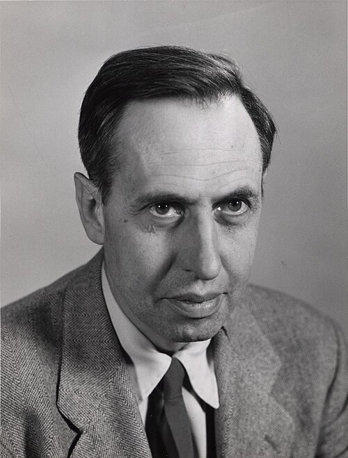

# 乔治·乌伦贝克

**英文名：** George Uhlenbeck

**生卒：** 1900年12月6日 — 1988年10月31日

**主要领域：** 量子力学、统计物理

肖像的作者、拍摄或创作年代及具体形式见图片来源。

## 生平简介

荷兰出生的理论物理学家，曾在莱顿大学学习，后长期在美国任教。他与古兹米特在青年时期提出电子自旋，并研究布朗运动、输运过程及统计物理基础。

## 对物理的主要贡献

- 与古兹米特共同提出电子自旋假说
- 与奥恩斯坦建立描述带阻尼随机运动的奥恩斯坦—乌伦贝克过程
- 研究量子气体和输运理论

## 肖像来源与许可

- 来源：[George_E_Uhlenbeck.jpg](https://commons.wikimedia.org/wiki/File:George_E_Uhlenbeck.jpg)
- 作者／署名：University of Michigan. News and Information Services.
- 许可：[CC BY 4.0](https://creativecommons.org/licenses/by/4.0)
- 本地文件：[386dd108d4f6d1a60121.jpg](../portraits/386dd108d4f6d1a60121.jpg)
- 原始来源说明：https://quod.lib.umich.edu/b/bhl/x-hs7284/hs7284

## 资料来源

- [Wikipedia: George Uhlenbeck](https://en.wikipedia.org/wiki/George_Uhlenbeck)

资料整理日期：2026-10-26。
