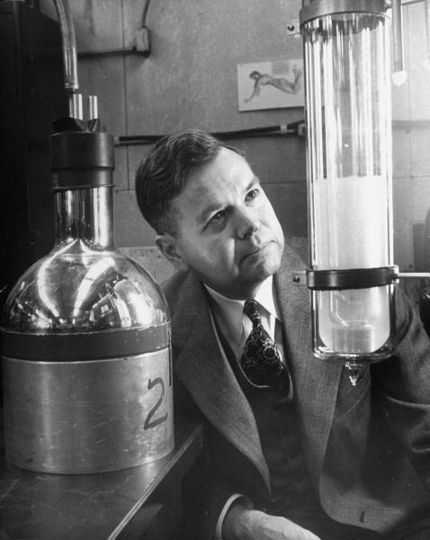

# 约翰·克拉克·斯莱特

**英文名：** John Clarke Slater

**生卒：** 1900年12月22日 — 1976年7月25日

**主要领域：** 原子物理、电子结构、凝聚态理论

肖像的作者、拍摄或创作年代及具体形式见图片来源。

## 生平简介

美国理论物理学家，曾在哈佛求学并长期在麻省理工学院领导物理研究，后来在佛罗里达大学工作。他把量子力学用于原子、分子和固体电子结构，重视可计算方法，并通过研究团队与教材培养理论物理人才。

## 对物理的主要贡献

- 发展并推广用斯莱特行列式表示反对称多电子波函数的方法
- 提出斯莱特型轨道与屏蔽规则，促进原子电子结构计算
- 发展局域交换近似等实用方法，推动分子与固体理论计算

## 肖像来源与许可

- 来源：[John_C_Slater_1949.jpg](https://commons.wikimedia.org/wiki/File:John_C_Slater_1949.jpg)
- 作者／署名：Alfred Eisenstaedt
- 许可：Public domain
- 本地文件：[792ce43b0278723fe0d0-b920ca2366.jpg](../portraits/792ce43b0278723fe0d0-b920ca2366.jpg)
- 原始来源说明：Google LIFE photo archive [1]

## 资料来源

- [National Academy of Sciences: John Slater](https://www.nasonline.org/directory-entry/john-slater-up2tib/)
- [Philip M. Morse: John Clarke Slater, NAS Biographical Memoir](https://www.nasonline.org/wp-content/uploads/2024/06/slater-john.pdf)
- [Wikipedia: John C. Slater](https://en.wikipedia.org/wiki/John_C._Slater)

资料整理日期：2026-10-26。
