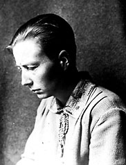

# 格蕾特·赫尔曼

**英文名：** Grete Hermann

**生卒：** 1901年3月2日 — 1984年4月15日

**主要领域：** 量子基础、数学物理

已核对对应人物条目使用的历史肖像；图像文件来自英语维基百科本地文件库。

## 生平简介

德国数学家、物理哲学家，曾在哥廷根师从诺特。她分析早期量子力学的逻辑与因果问题，反对纳粹并参与教育工作，其量子基础贡献长期未得到充分关注。

## 对物理的主要贡献

- 指出冯·诺伊曼排除隐变量论证所用假设的局限
- 研究量子理论中的因果性、测量和知识条件
- 推动量子力学的哲学与逻辑分析

## 史料说明

- 部分旧网页将死亡日期记为2月15日；欧洲数学女性组织刊载的生平研究及2024年《Physics Today》历史研究均记为1984年4月15日，本次采用后一日期。

## 肖像来源与许可

- 来源：[Grete_Hermann.jpg](https://en.wikipedia.org/wiki/File:Grete_Hermann.jpg)
- 作者／署名：见原图页面
- 许可：非自由历史照片或版权状态未确认；公开网页使用前需核查授权
- 本地文件：[e3216602d7ce0d488c36-f6c8ec0869.jpg](../portraits/e3216602d7ce0d488c36-f6c8ec0869.jpg)
- 授权状态：仅记录来源与本地档案副本；未确认可用于网站再发布，发布前须向权利人核实授权。

## 资料来源

- [Grete Hermann: philosopher and physicist — European Women in Mathematics](https://www.europeanwomeninmaths.org/wp-content/uploads/2016/02/gretehermann.pdf)
- [Grete Hermann’s ethical philosophy of physics — Physics Today (2024)](https://physicstoday.aip.org/features/grete-hermanns-ethical-philosophy-of-physics)
- [Wikipedia: Grete Hermann](https://en.wikipedia.org/wiki/Grete_Hermann)

资料整理日期：2026-10-26。
